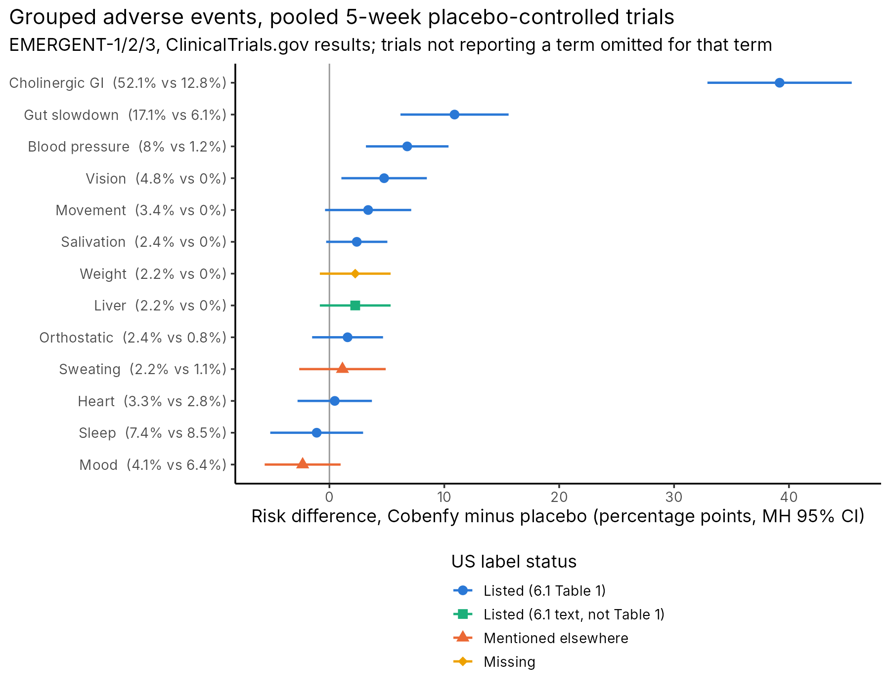
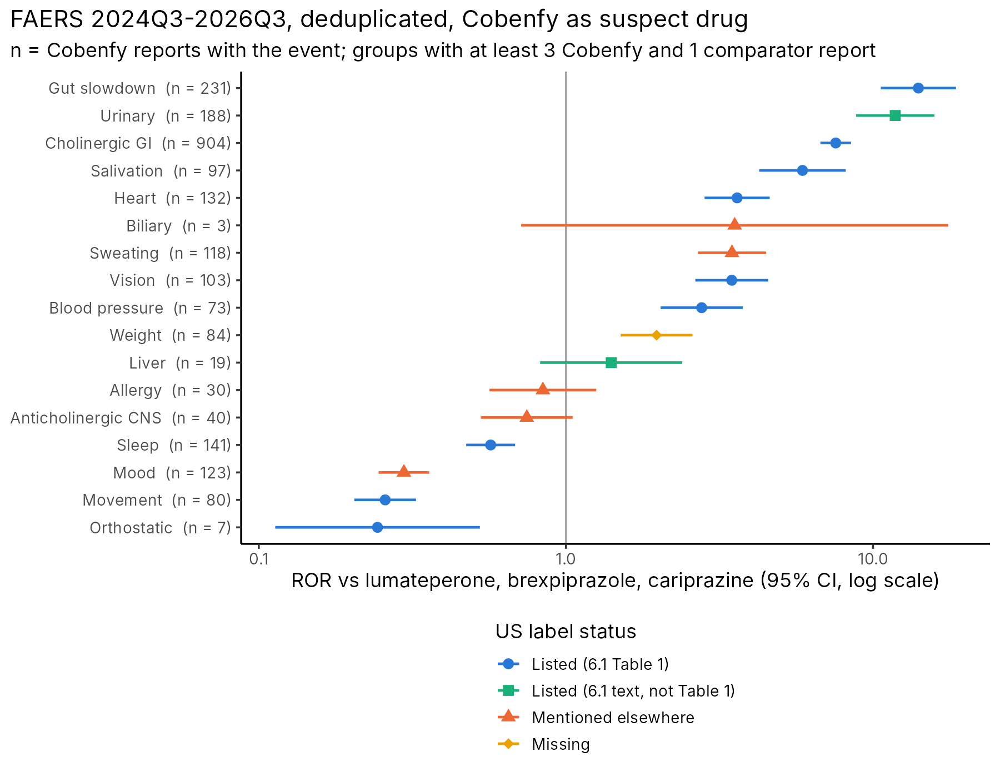

# Handover: Cobenfy trial side effects vs US label vs FAERS

Project folder: `12 Cobenfy Screen/trial_vs_label/` · Run date: 2026-11-13 · Branch: `claude/eloquent-ptolemy-epuobb`

**Bottom line.** No trial adverse event met the pre-specified "missing from label" rule. This is a clean but low-powered negative: public trial reports list only events above 2–5%, and the FDA review could not be downloaded. The best unlabelled event is **sweating (hyperhidrosis)**. It is weak in the RCTs (2.2% vs 1.1%), 5.1% in the 52-week study, and confirmed in FAERS (ROR 3.79, 2.85–5.03; health-professional reports 2.34, 1.48–3.70). The label mentions it only as an overdose sign. Novelty: partly known.

**Open decision.** Download the FDA multidisciplinary review (NDA 216158) by hand. The FDA site blocks scripts, and the review's tables of events under 2% are the only way to test rarer events.

Contents: 1. Summary (audit, Methods and Results, recap) · 2. Candidates and near-misses · 3. Figures · 4. Decisions log · 5. Files and how to reproduce

---

# 1. Summary

**FLAG:** The pre-specified screen found **0 candidates**. Public trial reports list only terms above 2% (EMERGENT-1/2) or 5% (EMERGENT-3), and the FDA review could not be retrieved. So events below those thresholds could not be tested in the trials.

## 1. What the code did

**Sources retrieved**
1. ClinicalTrials.gov API v2 search — xanomeline / KarXT / Cobenfy → 54 studies, 9 with posted results; full records saved → `raw/ctgov/*.json`
2. Parsed `adverseEventsModule` (serious + other, every term, every arm) — 9 studies → `raw/ctgov_ae_long.csv` (407 rows)
3. Europe PMC / PubMed search and open-access full texts — EMERGENT-1 NEJM (PMC7610870), EMERGENT-1 safety (PMC9719488), EMERGENT-3 JAMA Psychiatry + supplement (PMC11063924), phase 1 xanomeline vs combo (PMC10102054), FAERS papers (PMC13234482, PMC13639622), NMA (PMC13435969); abstracts of 18 non-open papers → `raw/europepmc/`, `raw/pubmed/`
4. DailyMed label — current SPL v6 (2026-08-21) and every version (v1, v3, v4, v5, v6) → `raw/label/`
5. FAERS quarterly ASCII files — 2024Q3–2026Q3 (9 quarters) → scratchpad (≈2 GB, not in repo)
6. **Not retrieved:** Drugs@FDA review and label PDFs (site returned a bot-block page); full texts of EMERGENT-2 (Lancet), pooled safety (J Clin Psychiatry), EMERGENT-4/5 papers, and Bodick 1997 (abstracts only).

**Processing** (scripts in `scripts/`, analysis in `analysis.Rmd`)

7. Built long table — CT.gov + journal tables (EMERGENT-1 Table 3, EMERGENT-3 Table 2, phase 1 Table 3, Bodick via Table 5) + label Table 1 + EMERGENT-5 abstract → `trial_ae_long.csv` (520 rows)
8. Defined grouped terms — 17 clinical groups + 5 label-footnote groups, 81 PT rows → `term_groups.csv`
9. Classified label status for 135 PTs, with each cited wording checked against the label text (0 failures) and first label version recorded → `label_status.csv` (42 listed, 18 mentioned elsewhere, 75 missing; all labelled content present since v1)
10. Pooled EMERGENT-1/2/3 — MH risk difference, Sato variance, no continuity correction, available-case; also unreported-as-zero, EMERGENT-1/2/3 + UNITE-001, label pool EMERGENT-2+3, ARISE, and largest-member group count → `pooled_ae.csv` (401 rows), `data/h2_pooled_results.xlsx`; Python and R implementations agree to ≤0.005 pp
11. Positive controls — EMERGENT-2+3 crude % vs label Table 1 → H1 tables
12. Candidate screen — lower bound > 0 in both missingness methods + label status Missing/Mentioned elsewhere → `data/h3_screen_results.xlsx`
13. FAERS extraction — antipsychotic-containing reports per quarter → `scripts/07_faers_extract.py`
14. FAERS dedup — latest caseversion per caseid (3,674,893 DEMO rows → 3,238,161 caseids), 14,555 deleted caseids removed → 3,223,606 cases; 130,953 with an antipsychotic → `data/faers_cases.csv.gz`, `data/faers_case_pt.csv.gz`
15. FAERS disproportionality — 153 events (PTs + groups); Cobenfy PS/SS (n = 2,841) vs newer APs (n = 10,060) and vs all APs (n = 99,237); HCP-only (1,203 vs 6,952 / 54,731); ROR (Woolf) and IC025 → `data/h4_faers_results.xlsx`
16. Long-term incidence — EMERGENT-4 (n = 152), EMERGENT-5 (n = 566), Wilson CI → `data/s1_longterm.xlsx`
17. Source agreement — journal tables vs CT.gov (52 count pairs, all identical); EMERGENT-5 abstract vs CT.gov (12 terms) → S2 tables
18. Audits — independent recount of FAERS from raw files (identical: 2,841 cases, hyperhidrosis 99); pilot replication vs lumateperone → `raw/pilot_check.txt`; novelty searches → `raw/novelty/`
19. Figures → `figures/forest_grouped_terms_trials.png`, `figures/forest_grouped_terms_faers.png`

**Not run:** incidence per 100 patient-years and time patterns (no exposure data in retrieved sources); urinary-retention positive control (below public reporting thresholds); extraction of FDA-review AE tables (not retrievable).

## 2. Methods and Results

**Methods.** We extracted adverse events from all 9 xanomeline-trospium studies with results on ClinicalTrials.gov, cross-checked them against published trial tables, and harmonised terms to MedDRA preferred terms. Synonyms were merged into 17 pre-specified clinical groups. For the three 5-week placebo-controlled trials (EMERGENT-1, -2, -3; 340 xanomeline-trospium, 343 placebo), we estimated Mantel-Haenszel risk differences stratified by trial, with Sato variance and no continuity correction. Registry reporting thresholds (2% in EMERGENT-1/2, 5% in EMERGENT-3) meant a term absent from a trial could not be counted. Analyses therefore used the trials reporting each term, and a sensitivity analysis set unreported terms to zero. An event was a candidate if the lower 95% bound exceeded zero in both analyses and the term was absent from the US label or appeared only outside Section 6.1 (DailyMed SPL versions 1–6). FAERS reports from 2024Q3–2026Q3 were deduplicated: we kept the latest case version and removed FDA-deleted cases. We then compared reports naming xanomeline-trospium as suspect drug with reports naming lumateperone, brexpiprazole or cariprazine (and, separately, any antipsychotic) without xanomeline-trospium. The measures were reporting odds ratios with 95% CIs and the information component (IC025), overall and in health-professional reports. Analyses used Python 3.13 and R with tidyverse.

**Results.** The pipeline reproduced label Table 1 within 1 percentage point for nausea (19.1% vs 3.6%; label 19% vs 4%), constipation (17.1% vs 7.1%; 17% vs 7%), dyspepsia (17.5% vs 4.7%; 18% vs 5%) and vomiting (15.1% vs 0.8%; 15% vs 1%). Urinary retention could not be checked because it fell below the reporting thresholds. Journal and registry counts agreed for all 52 matched pairs. In the pooled 5-week trials, eight preferred terms had a lower 95% bound above zero, and all eight are in label Table 1: nausea (RD 14.7 points, 10.1 to 19.3), vomiting (11.8, 7.9 to 15.7), constipation (10.9, 6.2 to 15.6), dyspepsia (10.6, 6.2 to 15.0), hypertension (6.8, 3.2 to 10.4), dry mouth (5.1, 1.5 to 8.8), vision blurred (4.8, 1.0 to 8.5) and gastroesophageal reflux disease (3.6, 1.3 to 5.8). No event met the candidate rule, and no grouped term met the understated rule. Headache, the negative control, did not differ (10.9% vs 10.2%; RD 0.7, −3.9 to 5.3). The strongest unlabelled near-miss was hyperhidrosis. In EMERGENT-1 it occurred in 2.2% vs 1.1% (RD 1.1, −2.6 to 4.9), it was not reported above threshold in the other trials, and it occurred in 5.1% (3.6 to 7.3) of 566 patients in the 52-week open-label EMERGENT-5. The label mentions it only as an overdose sign. In FAERS, the 2,841 xanomeline-trospium reports showed disproportionate hyperhidrosis compared with newer antipsychotics (99 reports; ROR 3.79, 2.85 to 5.03; IC025 0.87). This held in health-professional reports (ROR 2.34, 1.48 to 3.70) and against all antipsychotics (ROR 4.49, 3.63 to 5.56). Weight decreased, absent from the label, occurred in 5.7% in EMERGENT-5 and was disproportionate in FAERS (ROR 2.18, 1.58 to 2.99), but not in health-professional reports (1.56, 0.86 to 2.83). All five labelled positive controls were disproportionate in FAERS. Headache (ROR 0.56) and akathisia (0.11) were reported less often than with the comparators.

## 3. Recap

- I screened 9 trials, 6 label versions and 2,841 deduplicated FAERS reports. No trial adverse event met the pre-specified "missing from label" rule, so this is a clean negative screen, limited by the 2–5% registry reporting thresholds.
- The best unlabelled event is sweating/hyperhidrosis. In the RCTs it is weak (2.2% vs 1.1%, CI crosses 0), it reaches 5.1% in the 52-week study, and FAERS confirms it (ROR 3.79, 2.85–5.03; HCP 2.34, 1.48–3.70). The label lists it only under overdose. Novelty is partial: FAERS papers report the signal but treat it as labelled.
- Decision needed: whether to get the FDA multidisciplinary review by hand (the site blocks scripts), since its <2% tables are the only way to test rarer events.

---

# 2. Candidates and near-misses

### Result of the pre-specified rule: **0 candidates**

Rule: pooled EMERGENT-1/2/3 Cobenfy rate > placebo, MH risk-difference lower 95% bound > 0 (available-case **and** unreported-as-zero), and label status "Missing" or "Mentioned elsewhere".

Every PT or grouped term with a lower bound > 0 is already in label Table 1: nausea, vomiting, dyspepsia, constipation, hypertension, dry mouth, GERD, vision blurred. Headache, the negative control, was not flagged: 10.9% vs 10.2%, RD 0.67 (−3.92 to 5.25). This is a clean negative screen, but its power is low. Public trial reports list only terms above 2% (EMERGENT-1/2) or 5% (EMERGENT-3), so rarer events cannot be tested. Source: `data/h3_screen_results.xlsx`, `analysis.Rmd` H3.

No grouped term met the "understated" rule (H3.2).

---

### Best near-miss (post hoc): Sweating / hyperhidrosis

It fails the trial rule, but it is the only event with all four of: trial signal, label gap, FAERS confirmation, and mechanism.

| Evidence | Numbers | Source |
|---|---|---|
| RCT, EMERGENT-1 | 2/89 (2.2%) vs 1/90 (1.1%); RD 1.14 (−2.63 to 4.90) | CT.gov NCT03697252; NEJM 2021 Table 3 (identical) |
| RCT, EMERGENT-2 | not reported, so ≤2% in each arm | CT.gov NCT04659161 (threshold 2%) |
| RCT, EMERGENT-3 / UNITE-001 / ARISE | not reported, so ≤5% in each arm | CT.gov (threshold 5%) |
| 52-week open-label EMERGENT-5 | 29/566 (5.1%; Wilson 3.6–7.3) | CT.gov NCT04820309; Kaul 2026 abstract (PMID 41506001) says 5.1% |
| Xanomeline alone vs combo (phase 1, healthy volunteers) | sweating 16/33 (48.5%) vs 7/35 (20.0%) | Breier 2023, PMC10102054, Table 3 |
| Xanomeline alone, Alzheimer's (Bodick 1997, 225 mg/d) | placebo-adjusted 71% | cited in PMC10102054 Table 5 |
| **US label** | **Section 10 (Overdosage) only**, "hyperhidrosis" as a cholinergic overdose sign; absent from 6.1 and 6.2; unchanged since v1 (2024-09-26) | DailyMed SPL v1–v6 |
| FAERS vs newer APs (main) | 99 vs 95 reports; ROR 3.79 (2.85–5.03); IC025 0.87 | `data/h4_faers_results.xlsx` |
| FAERS vs newer APs (HCP only) | 26 reports; ROR 2.34 (1.48–3.70) | same |
| FAERS vs all APs | ROR 4.49 (3.63–5.56); IC025 1.64; HCP lower bound 1.79 | same |
| FAERS grouped "Sweating" (hyperhidrosis, cold sweat, night sweats) | 118 reports; ROR 3.47 (2.69–4.48); HCP 2.44 (1.61–3.70) | same |
| Pilot replication (vs lumateperone alone) | 99 vs 41; ROR 3.47 (2.41–5.02) | `raw/pilot_check.txt` |

**FAERS status:** confirmed (lower bound > 1 in the main and the HCP analysis).
**Novelty: partly known.**
- Bao 2026 (Neurotherapeutics, PMC13234482, Table 3) reported hyperhidrosis, 46 cases, ROR 10.56 (7.89–14.14) against all of FAERS. It filed hyperhidrosis among events "aligned with AEs listed on the drug label" and flagged only cold sweat as unlabelled.
- Leppien 2026 (PMC13639622) reported 62 cases, ROR 11.72 (9.11–15.07).
- EMERGENT-5 reports 5.1%.
- Sweating is the classic xanomeline effect that trospium only partly blocks.
- **Not found in the literature:** that the US label lists hyperhidrosis only as an overdose sign, and the FAERS signal against active antipsychotic comparators with HCP-only confirmation.

### Second near-miss: Weight decreased / decreased appetite

| Evidence | Numbers | Source |
|---|---|---|
| EMERGENT-1 decreased appetite | 2/89 vs 0/90; RD 2.25 (−0.83 to 5.33) | CT.gov / NEJM |
| UNITE-001 (China) weight decreased | 21/102 vs 16/98 | CT.gov NCT05919823 |
| "Weight" group, EMERGENT-1 + UNITE-001 | RD 5.29 (−1.12 to 11.71) | `pooled_ae.csv` |
| EMERGENT-5 weight decreased | 32/566 (5.7%; 4.0–7.9) | CT.gov; abstract 5.7% |
| Label | **Missing** (only "loss of appetite" as a symptom of liver problems in the Medication Guide) | SPL v6 |
| FAERS weight decreased vs newer APs | 62 reports; ROR 2.18 (1.58–2.99); HCP 1.56 (0.86–2.83) | `h4_faers_results.xlsx` |

**FAERS status:** not confirmed at PT level (the HCP lower bound is below 1). The "Weight" group passes (HCP lower bound 1.03). **Novelty:** not found as a flagged signal in the retrieved FAERS papers. EMERGENT-5 reports it. Weak; treat as a lead only.

### Presentation note (not a candidate)
Drooling is in label Table 1 only inside the "EPS, non-akathisia" footnote, not with salivary hypersecretion. In FAERS, drooling (57 reports; ROR 6.04, 3.94–9.25) outnumbers salivary hypersecretion (41). Trial data cannot test this, because drooling was not reported above threshold in any trial.

### Events Cobenfy is *less* often reported for in FAERS (for context)
Akathisia ROR 0.11, mood group 0.30, headache 0.56 (vs newer APs).

---

# 3. Figures

*Pooled EMERGENT-1/2/3 Mantel-Haenszel risk differences, coloured by US label status.*

*FAERS 2024Q3–2026Q3, Cobenfy vs lumateperone/brexpiprazole/cariprazine.*

---

# 4. Decisions log

Choices made without asking, as instructed. Each line: decision, and why.

### Sources
1. **Drugs@FDA (NDA 216158) review and label PDFs not retrieved.** `www.accessdata.fda.gov` returned an "abuse-detection / excessive requests" page (HTTP 404) to scripted downloads; the web-fetch tool could not resolve the host. I did not try to bypass the bot block. All label versions were taken from DailyMed instead (SPL versions 1, 3, 4, 5, 6; setid 8f0e73bf-6025-44f6-ab64-0983322de0df). DailyMed has no SPL version 2.
2. **EMERGENT-2 Lancet paper, pooled safety paper (Kaul 2025 J Clin Psychiatry), EMERGENT-4/5 full papers: not open access.** Only PubMed abstracts used (EMERGENT-5 abstract gives % for TEAEs ≥5%).
3. **Bodick 1997 (xanomeline alone, Alzheimer's): full text not accessible.** Used the abstract plus the placebo-adjusted rates that Breier 2023 (PMC10102054, Table 5) cites from Bodick. Marked "secondary citation" in `trial_ae_long.csv`.
4. Network access to FDA, DailyMed and FAERS hosts required a new personal cloud environment (approved at the session start); no credentials were used.

### Trial data
5. **ClinicalTrials.gov is the primary count source.** It is the only source with full per-arm counts for all trials. Journal tables were used for cross-checks.
6. **'Other' + 'serious' counts summed per PT.** CT.gov lists serious events separately from non-serious ones. Summing can double-count a patient who had both. In EMERGENT-5 this over-counted dizziness and dyspepsia by 1 patient each, compared with the paper abstract (S2).
7. **Reporting thresholds differ:** EMERGENT-1 and -2 used 2%, EMERGENT-3, UNITE-001, ARISE and EMERGENT-4/5 used 5%. A term missing from a trial is "below threshold in both arms", not zero. **Primary pool = available-case** (a trial contributes only to terms it reports). **Sensitivity = unreported treated as 0 in both arms.** A candidate must have a lower bound > 0 in **both**.
8. **Pools:** primary = EMERGENT-1/2/3 (as specified). Label positive controls use EMERGENT-2+3, because label Table 1 is the pool of these two trials (N = 251/253 = 126+125 / 125+128). Sensitivity: EMERGENT-1/2/3 + UNITE-001 (China, 5-week, placebo-controlled). ARISE (adjunctive) is pooled only in `pooled_ae.csv`, not in the main screen.
9. **Grouped-term count = sum of member PTs within a trial arm, capped at n.** Patient-level overlap is unknown. Sensitivity: largest single member.
10. **Term groups:** the prompt's lists were mapped to MedDRA PTs. A few direct synonyms were added (sinus tachycardia, BP orthostatic decreased, sedation, dystonia); these are marked "added" in `term_groups.csv`. Label-footnote groups (a–f) were added to reproduce label Table 1.
11. **MH risk difference:** MH weights n1·n0/(n1+n0), Sato/Greenland–Robins variance, no continuity correction (RevMan / metafor `rma.mh` formula). Implemented twice: Python (`scripts/05_pool.py`) and R (`analysis.Rmd`). The two agree to ≤0.005 percentage points, which is rounding.
12. **Long-term studies:** exposure time (patient-years) is not in any retrieved source, so incidence per 100 patient-years could **not** be computed. Crude cumulative incidence with Wilson CI is reported instead. Time pattern is also not available.

### Label
13. **Label status categories:** "Listed (6.1 Table 1)" includes footnote member terms. "Listed (6.1 text, not Table 1)" covers the 6.1 narrative (liver enzymes, urinary retention). "Mentioned elsewhere" covers 5.x, 6.2 and 10. The candidate rule treats 6.1 narrative as inside 6.1 (not a candidate).
14. A group's label status is the best status among its members.
15. **"Understated" rule:** group % ≥ 1.5× and ≥ 2 percentage points above the largest Table 1-listed member, with at least one member that is not itself a Table 1 term. Groups made only of listed PTs (e.g. "Cholinergic GI") are not flagged.
16. Every label mapping is checked automatically. `scripts/06_label_status.py` confirms each cited wording appears in the cited section; there were 0 failures.

### FAERS
17. Quarters 2024Q3–2026Q3 (9 files, latest available on 2026-11-13). Dedup: latest `caseversion` per `caseid` across all quarters (ties: latest `fda_dt`, then highest `primaryid`). Then caseids on any quarterly DELETE list are dropped.
18. **Exposure:** Cobenfy as primary or secondary suspect (PS/SS). **Comparator:** a comparator antipsychotic as PS/SS, and Cobenfy absent in any role. A Cobenfy case that also names a comparator stays in the Cobenfy group.
19. "All antipsychotics" = ATC N05A agents excluding lithium and antiemetic-only agents (prochlorperazine, promethazine, droperidol, metoclopramide). Pimavanserin is included (N05AX17).
20. Health professionals = `occp_cod` MD, PH, OT or HP.
21. ROR (Woolf CI) is set to NA when a cell is 0. IC uses Norén's shrinkage: log2((a+0.5)/(E+0.5)), and IC025 = IC − 3.3(a+0.5)^−½ − 2(a+0.5)^−3/2. E is computed within each Cobenfy-plus-comparator dataset.
22. **No trial candidate qualified, so FAERS was run on every PT and grouped term** (153 events). This shows how the near-misses behave in FAERS and checks the controls. The FAERS rule ("confirmed" = ROR lower bound > 1 in the main and the health-professional analysis vs newer antipsychotics) was applied unchanged.

### Code
23. House-style questions (robustness choices, figures, ANOVA) were not asked, per "do not ask". Decisions: robustness = items 7–9; figures = two forest plots; ANOVA not applicable.
24. FAERS clean data are saved as `.csv.gz`, not Excel (>500k rows). Raw FAERS quarterly files (~2 GB unzipped) are not in the repo; scripts 07–08 rebuild the extracts.
25. Bugs found and fixed during the run: a footnote-stripping regex removed real final letters ("Nausea" → "Nause"); "6.1 text, not Table 1" matched a "Table 1" test; a GGT term failed to map in S2; infinite RORs were written to Excel as text. All are fixed, and the outputs were re-knitted.

---

# 5. Files and how to reproduce

| File | What it is |
|---|---|
| `HANDOVER.md` | This document |
| `analysis.Rmd` / `.html` | Full analysis: cleaning, H1 controls, H2 pooling, H3 label screen, H4 FAERS, S1 long-term, S2 source agreement |
| `figures_tables.Rmd` / `.html` | Builds the two figures in `figures/` |
| `trial_ae_long.csv` | Every extracted AE count with its source location (520 rows) |
| `pooled_ae.csv` | Pooled rates, risk differences and CIs, all pools and methods (401 rows) |
| `term_groups.csv` | Exact PT lists for each grouped term |
| `label_status.csv` | Label status, exact label wording and first label version for 135 PTs |
| `data/*.xlsx` | Clean trial data and results tables per analysis block |
| `data/faers_*.csv.gz` | Deduplicated FAERS antipsychotic cases and case–PT pairs |
| `raw/` | Untouched source downloads (CT.gov JSON, label SPL XML v1–v6, papers, abstracts, novelty searches, pilot check) |
| `scripts/01–08` | Python download and parse steps |
| `SUMMARY.md`, `candidates.md`, `decisions_log.md` | Source sections merged into this file |

**Reproduce:** run `scripts/01_parse_ctgov.py` → `04_build_long.py` → `05_pool.py` → `06_label_status.py` (all with `python3 -I`). For FAERS, download the 9 quarterly ASCII zips from fis.fda.gov, then run `07_faers_extract.py <quarter_dir> <out_dir>` for each quarter and `08_faers_dedup.py <out_dir> data`. Then knit `analysis.Rmd` and `figures_tables.Rmd`. The raw FAERS files (~2 GB) are not in the repo.
