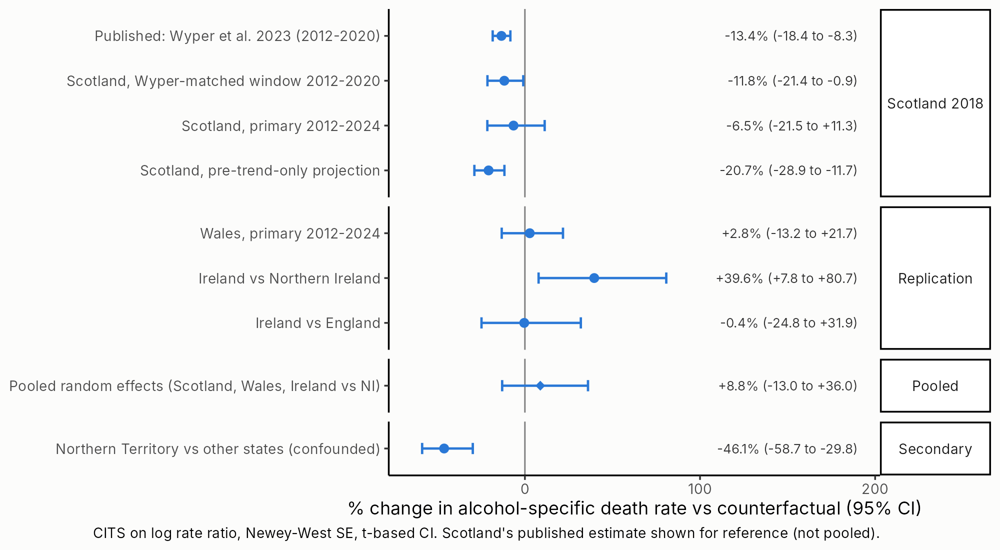
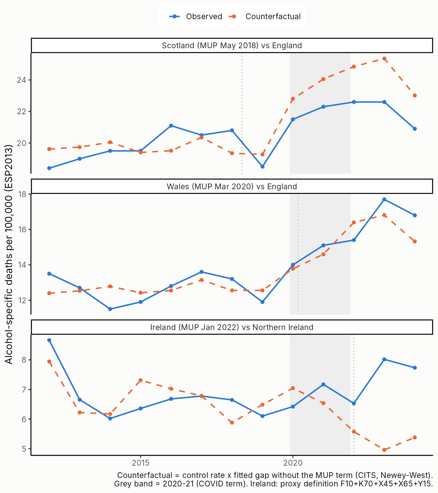
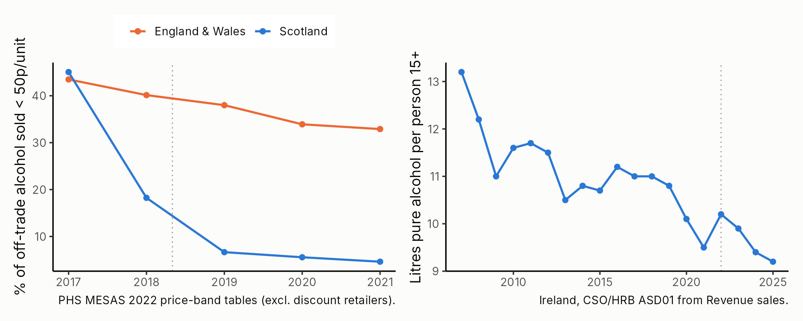
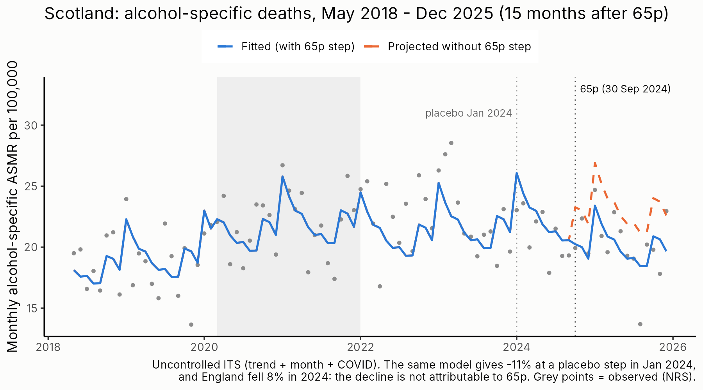
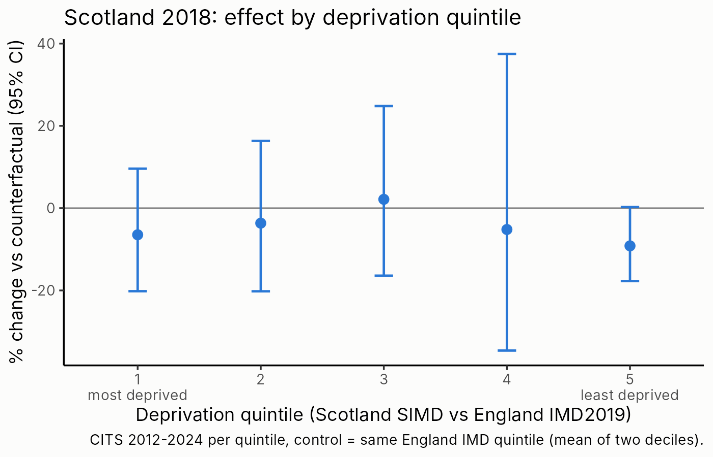
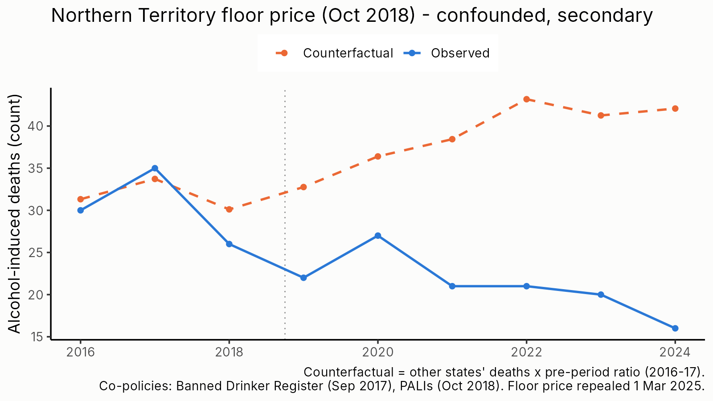
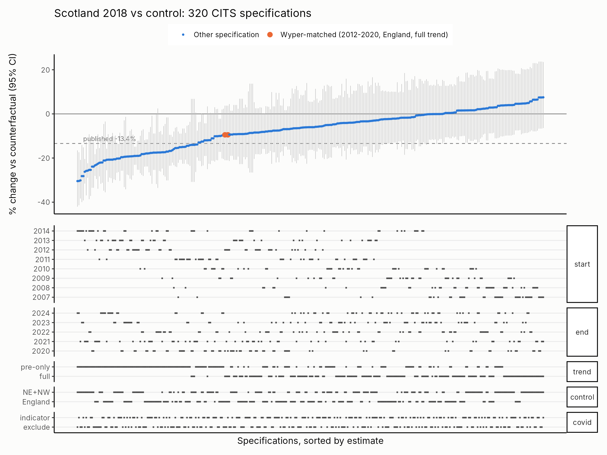
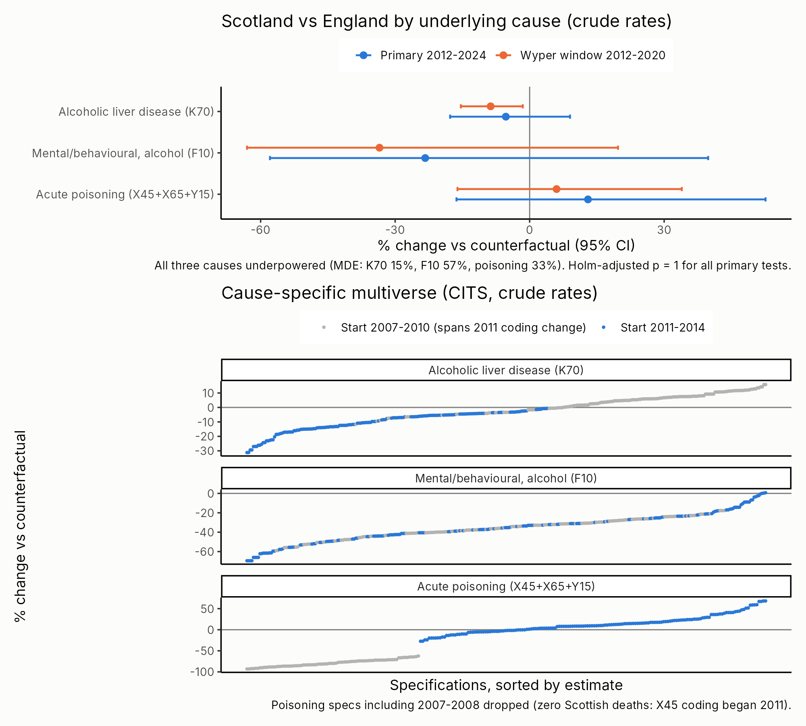

# 0. Status at handover

| Item | State |
|---|---|
| Project folder | `18 Minimum Unit Pricing/` |
| Git branch | `claude/new-session-qsw7kf` (pushed) |
| Commits | `5803f39` main analysis · `3a13287` multiverse spec freeze (before any H8/H9 data or models) · `80c865d` multiverse + cause split |
| Analysis code | `analysis.Rmd` (knits end to end), `figures_tables.Rmd`, `scripts/*.py` |
| Results object | `results.rds`: H0–H7, S1–S3, `h8_multiverse`, `h9_cause` |
| Decision log | `DECISIONS.md` (Appendix E): every decision timestamped |
| Pipeline stage | Analysis (step 4) done. Next: **hannes-05-draft** |

# 1. FLAGs: read first

**Run 1 (four jurisdictions)**

1. **The positive-control gate failed on the pre-specified window.** Scotland 2007–2024 gave +1.6% (95% CI −10.0 to +14.6), against a published −13.4% (−18.4 to −8.3). A placebo test diagnosed a misspecified pre-trend: a fake policy in 2016 gave +14.5%, p=0.005. **All windows were moved to start in 2012 (post-hoc).** After the fix, the gate passes only on the Wyper-matched window (2012–2020: −11.8%). The extended primary window gives −6.5%, outside the published CI.
2. **Q2, the 65p increase:** the −13.0% step at Oct 2024 **cannot be attributed to 65p**. A fake step at Jan 2024 gives −11.3% (p=0.001), and England also fell 8.0% in 2024. England's 2025 deaths are not yet published.
3. **Ireland:** the outcome is a 5-code proxy (F10+K70+X45+X65+Y15), covering 96–97% of UK alcohol-specific deaths. The result depends on the control: vs Northern Ireland +39.6%, vs England −0.4%.
4. **Northern Territory:** the floor price was repealed on 1 Mar 2025, so the data stop at 2024. Other alcohol policies started at the same time.
5. **Missing pieces:**
   - Wales admissions unavailable.
   - Welsh first-stage page references [REF NEEDED].
   - Ireland commencement order [REF NEEDED].
   - NT dates from peer-reviewed papers only.

**Run 2 (multiverse + cause split)**

6. **Cause split uses crude rates**, not age-standardised rates. Scotland 2022 cause × age data sit behind a browser check on the NRS web archive, which was not bypassed. An exploratory age-standardised version (2022 omitted) gives nearly the same estimates.
7. **2011 ICD-10 coding change:** acute intoxication moved from F10.0 to X45 in both nations, but by different amounts.
   - F10 and poisoning specs starting before 2011 cross this break.
   - 80 poisoning specs were dropped: Scotland recorded 0 deaths in 2007–2008.
   - The start ≥ 2011 summary was added after seeing the data and is labelled post-hoc.
8. **All three cause predictions are "uninformative"**: every cause is underpowered.

**Both runs**

9. **Environment hosts added (user-approved):** 19 statistics hosts, `www.nomisweb.co.uk`, and `webarchive.nrscotland.gov.uk` (unusable).
10. **House-style deviations:** `group_modify()` and `pmap()` loops for placebos and multiverse grids.

# 2. Bottom line

- **Scotland 2018 (50p):** the published reduction reproduces on its original window (−11.8%), but depends on specification.
  - Across 320 CITS specs: median −6.0%, negative in 78%.
  - Starting in 2011 or later: about −13%. Starting in 2007: about 0%.
  - All 40 demeaned synthetic-control specs are negative (median −15.5%), but none reaches placebo p < 0.05; with 11 units the minimum p is 0.09.
- **Wales 2020:** no detectable effect, +2.8% (−13.2 to +21.7). Underpowered: smallest detectable effect 22%.
- **Ireland 2022:** uninformative. The sign flips with the control, and the smallest detectable effect is 31%.
- **Scotland 65p (2024):** a decline is visible, but it began before the uprating and was shared with England. Wait for England 2025 data (~May 2027).
- **Deprivation:** no detectable gradient (underpowered).
- **By cause:** K70 and F10 lean negative and poisoning does not, as predicted, but all three are underpowered.

## Scorecard (0–10)

| Question | Novelty | First stage | Power | Big result | Rigor | Feasibility |
|---|---|---|---|---|---|---|
| Q1 Wales deaths | 8 | 5 | 3 | 2 | 6 | 8 |
| Q1 Ireland deaths | 9 | 3 | 2 | 2 | 3 | 7 |
| Q2 Scotland 65p | 10 | 6 | 5 | 2 | 3 | 4 (8 after May 2027) |
| Q3 Deprivation | 3 | 5 | 2 | 1 | 4 | 6 |
| Cause split (K70/F10/poisoning) | 6 | 6 | 2 | 2 | 4 | 6 |

# 3. Question and policies

| Jurisdiction | Start | Level | Later change | Main control |
|---|---|---|---|---|
| Scotland | 1 May 2018 (SSI 2018/135) | 50p/unit | 65p from 30 Sep 2024 (SSI 2024/128) | England |
| Wales | 2 Mar 2020 (WSI 2019/1472) | 50p/unit | 65p from 1 Oct 2026 (WSI 2026/34); too recent, logged only | England |
| Ireland | 4 Jan 2022 (s.11 Public Health (Alcohol) Act 2018) | €1.00 per 10 g | – | Northern Ireland, then England |
| Northern Territory | 1 Oct 2018 | A$1.30/standard drink | **Repealed 1 Mar 2025** | Other Australian states |

**Questions:**
- **Q1, replication:** does Scotland's effect on alcohol-specific deaths reproduce in Wales and Ireland?
- **Q2, dose:** did the 65p uprating reduce deaths further?
- **Q3, inequality:** are effects larger in more deprived areas?
- **Multiverse:** how robust is Scotland's effect to analytic choices?
- **Cause split:** which causes drive it?

**Novelty (Appendix C):**
- Deaths and admissions after MUP have **not** been evaluated at population level in Wales or Ireland.
- Scotland's 65p uprating has **no** empirical evaluation; there is only a modelling study (PLoS Med 2026).
- The positive-control target is Wyper et al., Lancet 2023 (PMID 36963415): deaths −13.4% (−18.4 to −8.3), admissions −4.1% (−8.3 to +0.3).

# 4. Data

| Data | Source (release) | Years used |
|---|---|---|
| UK alcohol-specific death rates by nation, region, sex (ESP2013) | ONS *Alcohol-specific deaths in the UK*, 2024 registrations (11 May 2026) | 2001–2024 |
| Scotland monthly rates, deprivation (SIMD), cause totals | NRS *Alcohol-specific deaths 2025* (27 Oct 2026) | 2000–2025 |
| England deprivation (IMD deciles); admissions; cancer mortality | OHID Fingertips 91380, 92906, 93959, 94004 | 2006–2024 |
| Scotland admissions | PHS ARHS open data (Dec 2024 release) | to 2023/24 |
| Scotland/England–Wales sales and price bands | PHS MESAS 2022 workbooks; PHS 2026 report (pp. 3, 5) | 1994–2025 |
| Ireland deaths by ICD-10 × age; population; per-capita sales; hospital discharges (HIPE) | CSO PxStat VSA35, VSA29, PEA01, ASD01, ASD09 | 2007–2025 |
| Australia alcohol-induced deaths by state | ABS *Causes of Death 2025* Table 13.17 | 2016–2024 |
| England/NE/NW deaths by cause × age; populations | Nomis NM_161_1, NM_31_1 | 2007–2024 |
| England/Scotland/regions deaths by cause × age | ONS individual-cause dataset (2001–2021); ONS ad hoc 11797 (2001–2018); NRS vital-events table 6.04 (2023, 2024) | 2007–2024 |

**Outcome:** the ONS alcohol-specific definition, 15 ICD-10 codes (Appendix G).

**Checks:**
- ESP2013 weights were validated against CSO's published rates: ratio 0.991–1.016.
- Computed England cause-specific rates match Nomis's published rates within 0.4%.
- Every overlap between spliced sources agrees exactly.

# 5. Methods

- **Main design:** controlled interrupted time series (CITS) on log(treated/control rate). Terms:
  - linear trend
  - fraction-of-year MUP term (Scotland 2018 = 8/12; Wales 2020 = 10/12; NT 2018 = 3/12)
  - 2020–21 COVID indicator
  - Newey–West SE (lag 1), t-based 95% CI
  - Window 2012–2024; 2007 kept as a sensitivity.
- **Robustness:**
  - demeaned synthetic control (donors: 9 English regions + NI), with leave-one-donor-out and RMSPE-ratio placebo
  - placebo-in-space
  - placebo dates 2 years early
  - North East + North West England control
  - excluding 2020–21
  - by sex
  - trend fitted on pre-policy years only
- **Pooling:** REML random effects (metafor).
- **Q2:** monthly time series of Scotland's rate, May 2018–Dec 2025, with month-of-year and COVID terms and a step at Oct 2024; placebo steps at Oct 2022 and Jan 2024.
- **Power:** minimum detectable effect at 80% power, from pre-period residual SD and the design-based SE.
- **Multiverse (frozen before any data were touched; Appendix D):**
  - CITS: start 2007–2014 × end 2020–2024 × trend (all years / pre-only) × control (England / NE+NW) × COVID (indicator / exclude) = 320 specs.
  - Synthetic control: start × end = 40 specs.
  - Cause split: K70, F10, poisoning (X45+X65+Y15). Primary 2012–2024, Wyper window 2012–2020, 960-spec cause multiverse, minimum detectable effect per cause, Holm across 3 tests.
- **Software:** R 4.3.3 (tidyverse 2.0.0, sandwich 3.1.0, lmtest, metafor 4.4.0, quadprog 1.5.8); Python 3 for harvesting.

# 6. Results

## 6.1 Positive control (Scotland 2018 vs England)

| Specification | Effect (95% CI) |
|---|---|
| Published, Wyper et al. 2023 | −13.4% (−18.4 to −8.3) |
| Wyper-matched window 2012–2020 | **−11.8% (−21.4 to −0.9), p=0.038**: gate passes |
| Primary 2012–2024 | −6.5% (−21.5 to +11.3) |
| Trend from pre-policy years only | −20.7% (−28.9 to −11.7) |
| Demeaned synthetic control | −17.7% (placebo rank p=0.18) |
| Original 2007–2024 window (failed) | +1.6% (−10.0 to +14.6) |

## 6.2 First stage

- **Scotland 50p:** off-trade volume sold below 50p fell from 45.1% (2017) to 6.7% (2019). England & Wales: 43.5% to 38.0%.
- **Scotland sales:** per-adult sales −4.4% vs England & Wales (−5.1 to −3.7).
- **Scotland 65p:** off-trade price per unit rose 72p → 78p (2024→2025), vs 67p → 69p in England & Wales.
- **Ireland:** per-capita sales −7.6% vs trend (−15.0 to +0.5; p=0.06); with a 2007 start, −2.8%.
- **Wales:** Billan et al. 2025 (purchase data); Welsh Government page references [REF NEEDED].

## 6.3 Q1 replication and pooling

| Estimate | Effect (95% CI) | Smallest detectable effect |
|---|---|---|
| Wales vs England | +2.8% (−13.2 to +21.7) | 21.8% (underpowered) |
| Ireland vs Northern Ireland | +39.6% (+7.8 to +80.7) | 31.4% (underpowered) |
| Ireland vs England | −0.4% (−24.8 to +31.9) | – |
| Pooled random effects (Scotland, Wales, Ireland) | +8.8% (−13.0 to +36.0); I² = 81% | – |
| Scotland (for comparison) | – | 12.4% (powered) |

Every Wales robustness check stayed between −3.0% and +4.3%. The Ireland placebo at 2020 gave +14.4% (p=0.085).

## 6.4 Q2: Scotland 65p

- **Monthly step at Oct 2024:** −13.0% (−20.2 to −5.2); smallest detectable effect 11.9%.
- **Placebo checks:**
  - Oct 2022: +0.6%.
  - **Jan 2024: −11.3% (p=0.001).** The decline started before the uprating.
- **Annual change 2023→2024:** Scotland −7.5%, England −8.0%.

## 6.5 Q3: deprivation

Effects by SIMD quintile vs England's IMD quintiles:

| Quintile | Effect |
|---|---|
| 1 (most deprived) | −6.5% |
| 2 | −3.7% |
| 3 | +2.1% |
| 4 | −5.2% |
| 5 (least deprived) | −9.2% |

There is no gradient (slope p=0.79), and the analysis is underpowered. Welsh deprivation (WIMD) data start in 2018, so Wales could not be estimated.

## 6.6 Secondary outcomes

- **Negative controls:**
  - Scotland all-cancer: +1.6% (−0.5 to +3.8).
  - Ireland non-alcohol cancers: +1.0% (−1.9 to +4.1).
- **Partly attributable (oesophageal cancer):**
  - Scotland: +3.6%.
  - Ireland: −8.6% (−14.5 to −2.2). This is an own-trend time series with no control group.
- **Admissions:**
  - Scotland vs England: −18.9% (only 2 pre-years). Scotland's own trend: +5.4%.
  - Ireland vs England: −14.8%. Ireland's own trend: −15.8%.
  - The comparisons disagree, so the evidence is inconclusive.
- **Northern Territory:** −46.1% (−58.7 to −29.8; placebo-in-space p=0.125). Confounded by the Banned Drinker Register and police liquor inspectors.

## 6.7 Multiverse (H8)

| Subset | n | Median effect (IQR) | % negative | % negative with p<0.05 |
|---|---|---|---|---|
| All CITS specs | 320 | −6.0% (−14.0 to −0.2) | 78.4 | 26.6 |
| Start 2007 | 40 | +2.7% | 30 | 5 |
| Start 2012 | 40 | −13.1% | 100 | 50 |
| Start 2014 | 40 | −15.6% | 100 | 47.5 |
| Trend: pre-policy years only | 160 | −13.4% | 91.2 | 53.1 |
| Trend: all years | 160 | −2.3% | 65.6 | 0 |
| Control England / NE+NW | 160 / 160 | −6.7% / −4.8% | 86.2 / 70.6 | 29.4 / 23.8 |
| Demeaned synthetic control | 40 | −15.5% (−17.2 to −14.2) | 100 | placebo p 0.09–0.36 |

The Wyper-matched grid specs gave −9.5% (−21.0 to +3.7). Full by-dimension tables are in `figures/table6*.csv`.

## 6.8 Cause split (H9; crude rates)

| Cause | Primary 2012–2024 (95% CI) | Wyper 2012–2020 (95% CI) | Smallest detectable effect | Prediction |
|---|---|---|---|---|
| K70 alcoholic liver disease | −5.3% (−17.7 to +9.0) | −8.7% (−15.3 to −1.5), p=0.026 | 15.4% | P1: uninformative |
| F10 mental/behavioural | −23.3% (−57.9 to +39.8) | −33.5% (−63.0 to +19.7) | 57.3% | P2: uninformative |
| Acute poisoning | +13.0% (−16.3 to +52.6) | +6.0% (−16.1 to +33.9) | 32.7% | P3: uninformative |

- Holm-adjusted p = 1.0 for all three primary tests.
- Cause multiverse medians: K70 −3.4%, F10 −35.3%, poisoning −1.9%.
- Post-hoc, start ≥ 2011 only: K70 −8.9% (100% negative), F10 −36.6%, poisoning +9.4%.

# 7. Open items and next steps

1. **Pipeline:** next step is hannes-05-draft. Decide first whether the paper's headline is the start-year sensitivity, or a 2011+ window justified independently of these results.
2. **Q2:** rerun with ONS England 2025 deaths (expected ~May 2027).
3. **Request from NRS:** Scotland 2022 deaths by cause × age. This lifts the crude-rate FLAG and allows age-standardised rates as the H9 primary.
4. **References to fill:**
   - Welsh Government evaluation reports (Jan 2025): purchase and price numbers with page references.
   - Ireland MUP commencement statutory instrument.
   - NT official sources (nt.gov.au).
5. **Wales admissions:** stats.gov.wales is not allowlisted; Public Health Wales would be the source.
6. **Hosts that would help next time:** `stats.gov.wales`, `www.irishstatutebook.ie`, `nt.gov.au`.

# 8. How to reproduce

**Run order** (from the project folder):

1. `python3 -I scripts/01_harvest_raw.py` → `03_mup_raw.xlsx` (needs the downloads in `raw/`)
2. `python3 -I scripts/03_harvest_cause.py` → `03_mup_raw_cause.xlsx`
3. `Rscript -e 'rmarkdown::render("analysis.Rmd")'` → `clean_data.xlsx`, `results.rds`, `analysis.html`
4. Render `figures_tables.Rmd`, then run its final `eval = FALSE` chunk → `figures/`
5. `scripts/02_extract_results.R` prints the headline estimates.

**Files:**

| File | Content |
|---|---|
| `raw/` | Original downloads, unchanged (two large files are git-ignored: the CSO catalogue and the ABS zip) |
| `03_mup_raw.xlsx`, `03_mup_raw_cause.xlsx` | Harvested raw sheets, values unchanged |
| `clean_data.xlsx` | Harmonised panel plus one sheet per source, including cause-specific rates |
| `analysis.Rmd` / `.html` | Blocks H0–H9, S1–S3 |
| `figures_tables.Rmd` / `.html` | Figures 1–7, tables 6–7 |
| `results.rds` | Every model, vcov and summary |
| `outcome_codes.csv` | ICD-10 definition |
| `00_novelty.md`, `literature_log.md` | Novelty review and search log |
| `multiverse_specs.md` | Frozen H8/H9 plan |
| `DECISIONS.md` | Timestamped decision log |
| `SUMMARY.md`, `SUMMARY_multiverse.md` | Code summaries for each run |

**Environment:** the cloud environment `RR1203.github.io` now allowlists the UK, Irish, Australian and Nomis statistics hosts. R packages come from Debian `r-cran-*`.

# Appendices

The appendices reproduce the project documents verbatim.
