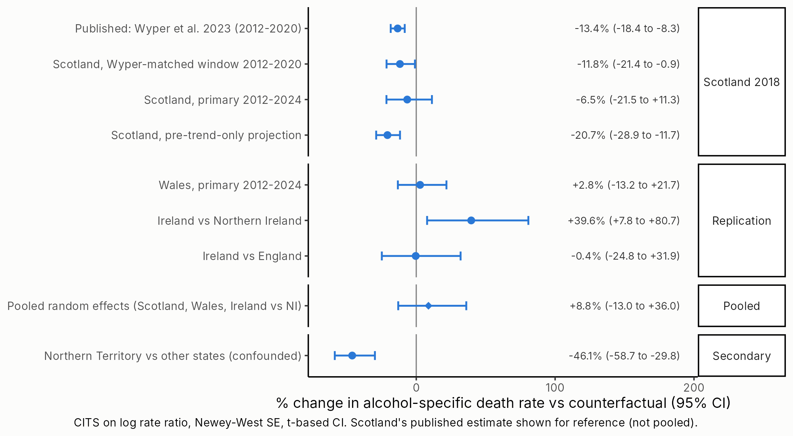
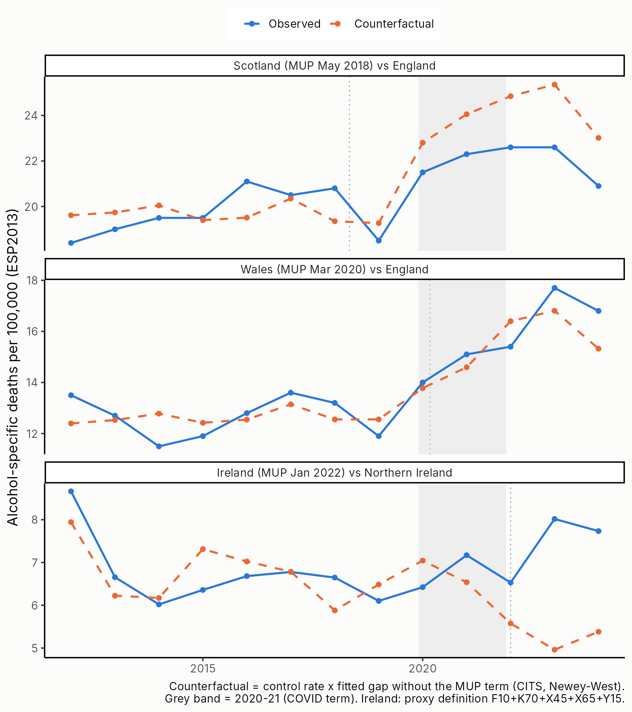
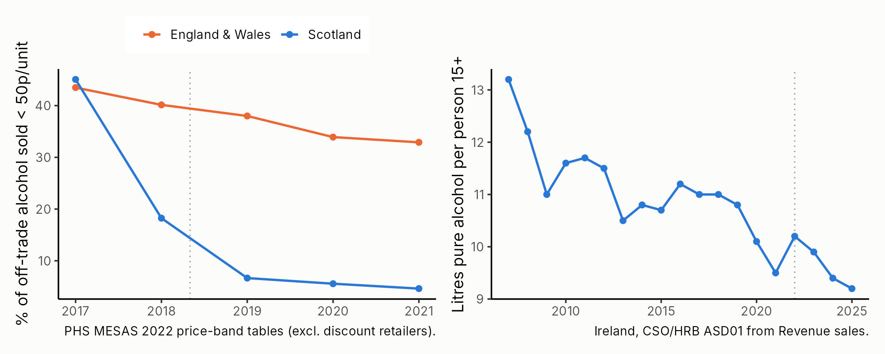
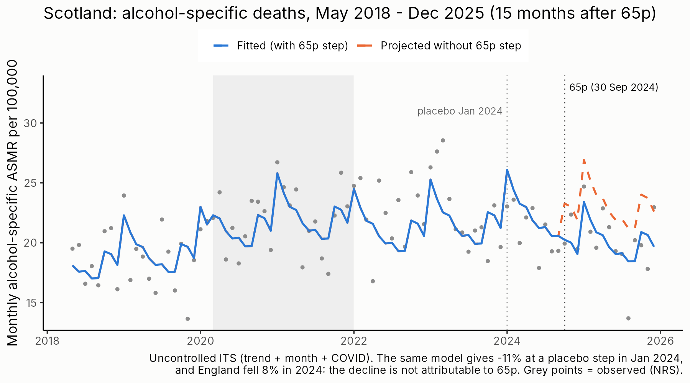
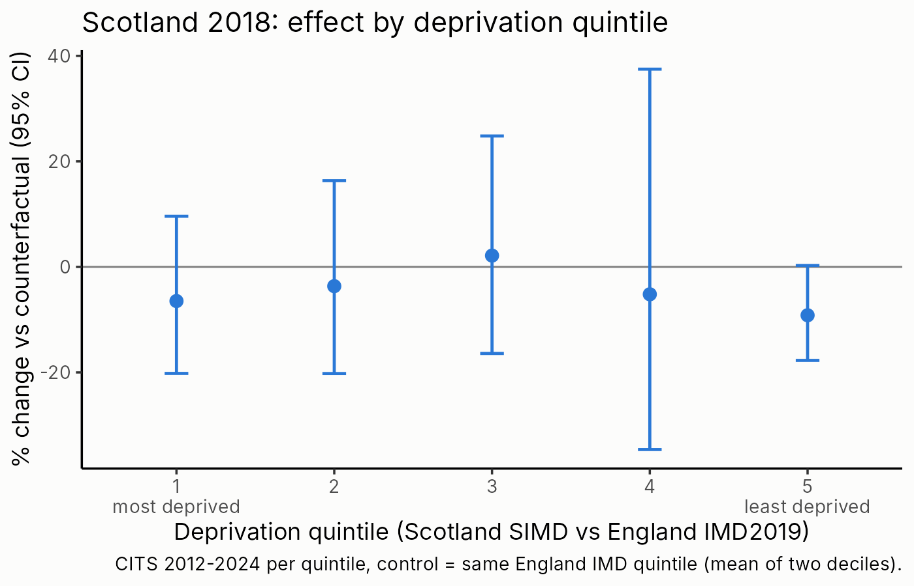
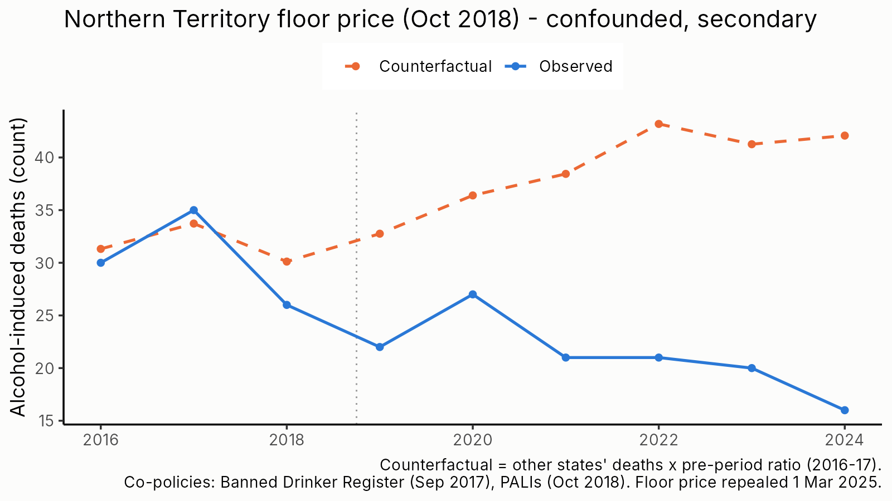
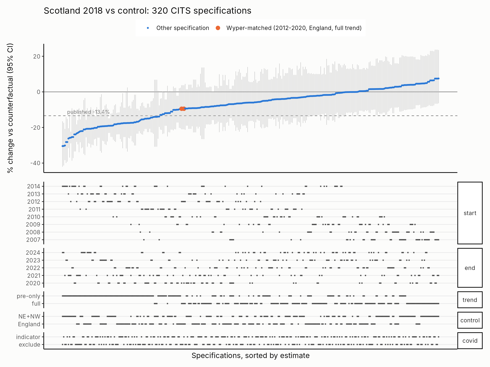
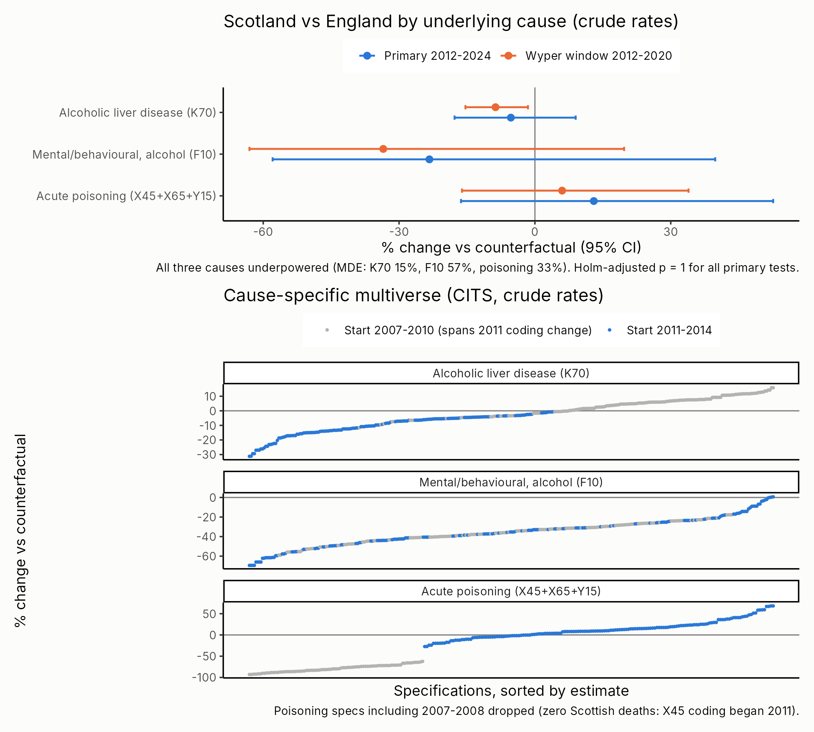

# 0. Status at handover

| Item | State |
|---|---|
| Project folder | `18 Minimum Unit Pricing/` |
| Git branch | `claude/new-session-qsw7kf` (pushed) |
| Commits | `5803f39` main analysis · `3a13287` multiverse spec freeze (before any H8/H9 data or models) · `80c865d` multiverse + cause split |
| Analysis code | `analysis.Rmd` (knits end to end), `figures_tables.Rmd`, `scripts/*.py` |
| Results object | `results.rds`: H0–H7, S1–S3, `h8_multiverse`, `h9_cause` |
| Decision log | `DECISIONS.md` (Appendix E): every decision timestamped |
| Pipeline stage | Analysis (step 4) done. Next: **hannes-05-draft** |

# 1. FLAGs: read first

**Run 1 (four jurisdictions)**

1. **The positive-control gate failed on the pre-specified window.** Scotland 2007–2024 gave +1.6% (95% CI −10.0 to +14.6), against a published −13.4% (−18.4 to −8.3). A placebo test diagnosed a misspecified pre-trend: a fake policy in 2016 gave +14.5%, p=0.005. **All windows were moved to start in 2012 (post-hoc).** After the fix, the gate passes only on the Wyper-matched window (2012–2020: −11.8%). The extended primary window gives −6.5%, outside the published CI.
2. **Q2, the 65p increase:** the −13.0% step at Oct 2024 **cannot be attributed to 65p**. A fake step at Jan 2024 gives −11.3% (p=0.001), and England also fell 8.0% in 2024. England's 2025 deaths are not yet published.
3. **Ireland:** the outcome is a 5-code proxy (F10+K70+X45+X65+Y15), covering 96–97% of UK alcohol-specific deaths. The result depends on the control: vs Northern Ireland +39.6%, vs England −0.4%.
4. **Northern Territory:** the floor price was repealed on 1 Mar 2025, so the data stop at 2024. Other alcohol policies started at the same time.
5. **Missing pieces:**
   - Wales admissions unavailable.
   - Welsh first-stage page references [REF NEEDED].
   - Ireland commencement order [REF NEEDED].
   - NT dates from peer-reviewed papers only.

**Run 2 (multiverse + cause split)**

6. **Cause split uses crude rates**, not age-standardised rates. Scotland 2022 cause × age data sit behind a browser check on the NRS web archive, which was not bypassed. An exploratory age-standardised version (2022 omitted) gives nearly the same estimates.
7. **2011 ICD-10 coding change:** acute intoxication moved from F10.0 to X45 in both nations, but by different amounts.
   - F10 and poisoning specs starting before 2011 cross this break.
   - 80 poisoning specs were dropped: Scotland recorded 0 deaths in 2007–2008.
   - The start ≥ 2011 summary was added after seeing the data and is labelled post-hoc.
8. **All three cause predictions are "uninformative"**: every cause is underpowered.

**Both runs**

9. **Environment hosts added (user-approved):** 19 statistics hosts, `www.nomisweb.co.uk`, and `webarchive.nrscotland.gov.uk` (unusable).
10. **House-style deviations:** `group_modify()` and `pmap()` loops for placebos and multiverse grids.

# 2. Bottom line

- **Scotland 2018 (50p):** the published reduction reproduces on its original window (−11.8%), but depends on specification.
  - Across 320 CITS specs: median −6.0%, negative in 78%.
  - Starting in 2011 or later: about −13%. Starting in 2007: about 0%.
  - All 40 demeaned synthetic-control specs are negative (median −15.5%), but none reaches placebo p < 0.05; with 11 units the minimum p is 0.09.
- **Wales 2020:** no detectable effect, +2.8% (−13.2 to +21.7). Underpowered: smallest detectable effect 22%.
- **Ireland 2022:** uninformative. The sign flips with the control, and the smallest detectable effect is 31%.
- **Scotland 65p (2024):** a decline is visible, but it began before the uprating and was shared with England. Wait for England 2025 data (~May 2027).
- **Deprivation:** no detectable gradient (underpowered).
- **By cause:** K70 and F10 lean negative and poisoning does not, as predicted, but all three are underpowered.

## Scorecard (0–10)

| Question | Novelty | First stage | Power | Big result | Rigor | Feasibility |
|---|---|---|---|---|---|---|
| Q1 Wales deaths | 8 | 5 | 3 | 2 | 6 | 8 |
| Q1 Ireland deaths | 9 | 3 | 2 | 2 | 3 | 7 |
| Q2 Scotland 65p | 10 | 6 | 5 | 2 | 3 | 4 (8 after May 2027) |
| Q3 Deprivation | 3 | 5 | 2 | 1 | 4 | 6 |
| Cause split (K70/F10/poisoning) | 6 | 6 | 2 | 2 | 4 | 6 |

# 3. Question and policies

| Jurisdiction | Start | Level | Later change | Main control |
|---|---|---|---|---|
| Scotland | 1 May 2018 (SSI 2018/135) | 50p/unit | 65p from 30 Sep 2024 (SSI 2024/128) | England |
| Wales | 2 Mar 2020 (WSI 2019/1472) | 50p/unit | 65p from 1 Oct 2026 (WSI 2026/34); too recent, logged only | England |
| Ireland | 4 Jan 2022 (s.11 Public Health (Alcohol) Act 2018) | €1.00 per 10 g | – | Northern Ireland, then England |
| Northern Territory | 1 Oct 2018 | A$1.30/standard drink | **Repealed 1 Mar 2025** | Other Australian states |

**Questions:**
- **Q1, replication:** does Scotland's effect on alcohol-specific deaths reproduce in Wales and Ireland?
- **Q2, dose:** did the 65p uprating reduce deaths further?
- **Q3, inequality:** are effects larger in more deprived areas?
- **Multiverse:** how robust is Scotland's effect to analytic choices?
- **Cause split:** which causes drive it?

**Novelty (Appendix C):**
- Deaths and admissions after MUP have **not** been evaluated at population level in Wales or Ireland.
- Scotland's 65p uprating has **no** empirical evaluation; there is only a modelling study (PLoS Med 2026).
- The positive-control target is Wyper et al., Lancet 2023 (PMID 36963415): deaths −13.4% (−18.4 to −8.3), admissions −4.1% (−8.3 to +0.3).

# 4. Data

| Data | Source (release) | Years used |
|---|---|---|
| UK alcohol-specific death rates by nation, region, sex (ESP2013) | ONS *Alcohol-specific deaths in the UK*, 2024 registrations (11 May 2026) | 2001–2024 |
| Scotland monthly rates, deprivation (SIMD), cause totals | NRS *Alcohol-specific deaths 2025* (27 Oct 2026) | 2000–2025 |
| England deprivation (IMD deciles); admissions; cancer mortality | OHID Fingertips 91380, 92906, 93959, 94004 | 2006–2024 |
| Scotland admissions | PHS ARHS open data (Dec 2024 release) | to 2023/24 |
| Scotland/England–Wales sales and price bands | PHS MESAS 2022 workbooks; PHS 2026 report (pp. 3, 5) | 1994–2025 |
| Ireland deaths by ICD-10 × age; population; per-capita sales; hospital discharges (HIPE) | CSO PxStat VSA35, VSA29, PEA01, ASD01, ASD09 | 2007–2025 |
| Australia alcohol-induced deaths by state | ABS *Causes of Death 2025* Table 13.17 | 2016–2024 |
| England/NE/NW deaths by cause × age; populations | Nomis NM_161_1, NM_31_1 | 2007–2024 |
| England/Scotland/regions deaths by cause × age | ONS individual-cause dataset (2001–2021); ONS ad hoc 11797 (2001–2018); NRS vital-events table 6.04 (2023, 2024) | 2007–2024 |

**Outcome:** the ONS alcohol-specific definition, 15 ICD-10 codes (Appendix G).

**Checks:**
- ESP2013 weights were validated against CSO's published rates: ratio 0.991–1.016.
- Computed England cause-specific rates match Nomis's published rates within 0.4%.
- Every overlap between spliced sources agrees exactly.

# 5. Methods

- **Main design:** controlled interrupted time series (CITS) on log(treated/control rate). Terms:
  - linear trend
  - fraction-of-year MUP term (Scotland 2018 = 8/12; Wales 2020 = 10/12; NT 2018 = 3/12)
  - 2020–21 COVID indicator
  - Newey–West SE (lag 1), t-based 95% CI
  - Window 2012–2024; 2007 kept as a sensitivity.
- **Robustness:**
  - demeaned synthetic control (donors: 9 English regions + NI), with leave-one-donor-out and RMSPE-ratio placebo
  - placebo-in-space
  - placebo dates 2 years early
  - North East + North West England control
  - excluding 2020–21
  - by sex
  - trend fitted on pre-policy years only
- **Pooling:** REML random effects (metafor).
- **Q2:** monthly time series of Scotland's rate, May 2018–Dec 2025, with month-of-year and COVID terms and a step at Oct 2024; placebo steps at Oct 2022 and Jan 2024.
- **Power:** minimum detectable effect at 80% power, from pre-period residual SD and the design-based SE.
- **Multiverse (frozen before any data were touched; Appendix D):**
  - CITS: start 2007–2014 × end 2020–2024 × trend (all years / pre-only) × control (England / NE+NW) × COVID (indicator / exclude) = 320 specs.
  - Synthetic control: start × end = 40 specs.
  - Cause split: K70, F10, poisoning (X45+X65+Y15). Primary 2012–2024, Wyper window 2012–2020, 960-spec cause multiverse, minimum detectable effect per cause, Holm across 3 tests.
- **Software:** R 4.3.3 (tidyverse 2.0.0, sandwich 3.1.0, lmtest, metafor 4.4.0, quadprog 1.5.8); Python 3 for harvesting.

# 6. Results

## 6.1 Positive control (Scotland 2018 vs England)

| Specification | Effect (95% CI) |
|---|---|
| Published, Wyper et al. 2023 | −13.4% (−18.4 to −8.3) |
| Wyper-matched window 2012–2020 | **−11.8% (−21.4 to −0.9), p=0.038**: gate passes |
| Primary 2012–2024 | −6.5% (−21.5 to +11.3) |
| Trend from pre-policy years only | −20.7% (−28.9 to −11.7) |
| Demeaned synthetic control | −17.7% (placebo rank p=0.18) |
| Original 2007–2024 window (failed) | +1.6% (−10.0 to +14.6) |

## 6.2 First stage

- **Scotland 50p:** off-trade volume sold below 50p fell from 45.1% (2017) to 6.7% (2019). England & Wales: 43.5% to 38.0%.
- **Scotland sales:** per-adult sales −4.4% vs England & Wales (−5.1 to −3.7).
- **Scotland 65p:** off-trade price per unit rose 72p → 78p (2024→2025), vs 67p → 69p in England & Wales.
- **Ireland:** per-capita sales −7.6% vs trend (−15.0 to +0.5; p=0.06); with a 2007 start, −2.8%.
- **Wales:** Billan et al. 2025 (purchase data); Welsh Government page references [REF NEEDED].

## 6.3 Q1 replication and pooling

| Estimate | Effect (95% CI) | Smallest detectable effect |
|---|---|---|
| Wales vs England | +2.8% (−13.2 to +21.7) | 21.8% (underpowered) |
| Ireland vs Northern Ireland | +39.6% (+7.8 to +80.7) | 31.4% (underpowered) |
| Ireland vs England | −0.4% (−24.8 to +31.9) | – |
| Pooled random effects (Scotland, Wales, Ireland) | +8.8% (−13.0 to +36.0); I² = 81% | – |
| Scotland (for comparison) | – | 12.4% (powered) |

Every Wales robustness check stayed between −3.0% and +4.3%. The Ireland placebo at 2020 gave +14.4% (p=0.085).

## 6.4 Q2: Scotland 65p

- **Monthly step at Oct 2024:** −13.0% (−20.2 to −5.2); smallest detectable effect 11.9%.
- **Placebo checks:**
  - Oct 2022: +0.6%.
  - **Jan 2024: −11.3% (p=0.001).** The decline started before the uprating.
- **Annual change 2023→2024:** Scotland −7.5%, England −8.0%.

## 6.5 Q3: deprivation

Effects by SIMD quintile vs England's IMD quintiles:

| Quintile | Effect |
|---|---|
| 1 (most deprived) | −6.5% |
| 2 | −3.7% |
| 3 | +2.1% |
| 4 | −5.2% |
| 5 (least deprived) | −9.2% |

There is no gradient (slope p=0.79), and the analysis is underpowered. Welsh deprivation (WIMD) data start in 2018, so Wales could not be estimated.

## 6.6 Secondary outcomes

- **Negative controls:**
  - Scotland all-cancer: +1.6% (−0.5 to +3.8).
  - Ireland non-alcohol cancers: +1.0% (−1.9 to +4.1).
- **Partly attributable (oesophageal cancer):**
  - Scotland: +3.6%.
  - Ireland: −8.6% (−14.5 to −2.2). This is an own-trend time series with no control group.
- **Admissions:**
  - Scotland vs England: −18.9% (only 2 pre-years). Scotland's own trend: +5.4%.
  - Ireland vs England: −14.8%. Ireland's own trend: −15.8%.
  - The comparisons disagree, so the evidence is inconclusive.
- **Northern Territory:** −46.1% (−58.7 to −29.8; placebo-in-space p=0.125). Confounded by the Banned Drinker Register and police liquor inspectors.

## 6.7 Multiverse (H8)

| Subset | n | Median effect (IQR) | % negative | % negative with p<0.05 |
|---|---|---|---|---|
| All CITS specs | 320 | −6.0% (−14.0 to −0.2) | 78.4 | 26.6 |
| Start 2007 | 40 | +2.7% | 30 | 5 |
| Start 2012 | 40 | −13.1% | 100 | 50 |
| Start 2014 | 40 | −15.6% | 100 | 47.5 |
| Trend: pre-policy years only | 160 | −13.4% | 91.2 | 53.1 |
| Trend: all years | 160 | −2.3% | 65.6 | 0 |
| Control England / NE+NW | 160 / 160 | −6.7% / −4.8% | 86.2 / 70.6 | 29.4 / 23.8 |
| Demeaned synthetic control | 40 | −15.5% (−17.2 to −14.2) | 100 | placebo p 0.09–0.36 |

The Wyper-matched grid specs gave −9.5% (−21.0 to +3.7). Full by-dimension tables are in `figures/table6*.csv`.

## 6.8 Cause split (H9; crude rates)

| Cause | Primary 2012–2024 (95% CI) | Wyper 2012–2020 (95% CI) | Smallest detectable effect | Prediction |
|---|---|---|---|---|
| K70 alcoholic liver disease | −5.3% (−17.7 to +9.0) | −8.7% (−15.3 to −1.5), p=0.026 | 15.4% | P1: uninformative |
| F10 mental/behavioural | −23.3% (−57.9 to +39.8) | −33.5% (−63.0 to +19.7) | 57.3% | P2: uninformative |
| Acute poisoning | +13.0% (−16.3 to +52.6) | +6.0% (−16.1 to +33.9) | 32.7% | P3: uninformative |

- Holm-adjusted p = 1.0 for all three primary tests.
- Cause multiverse medians: K70 −3.4%, F10 −35.3%, poisoning −1.9%.
- Post-hoc, start ≥ 2011 only: K70 −8.9% (100% negative), F10 −36.6%, poisoning +9.4%.

# 7. Open items and next steps

1. **Pipeline:** next step is hannes-05-draft. Decide first whether the paper's headline is the start-year sensitivity, or a 2011+ window justified independently of these results.
2. **Q2:** rerun with ONS England 2025 deaths (expected ~May 2027).
3. **Request from NRS:** Scotland 2022 deaths by cause × age. This lifts the crude-rate FLAG and allows age-standardised rates as the H9 primary.
4. **References to fill:**
   - Welsh Government evaluation reports (Jan 2025): purchase and price numbers with page references.
   - Ireland MUP commencement statutory instrument.
   - NT official sources (nt.gov.au).
5. **Wales admissions:** stats.gov.wales is not allowlisted; Public Health Wales would be the source.
6. **Hosts that would help next time:** `stats.gov.wales`, `www.irishstatutebook.ie`, `nt.gov.au`.

# 8. How to reproduce

**Run order** (from the project folder):

1. `python3 -I scripts/01_harvest_raw.py` → `03_mup_raw.xlsx` (needs the downloads in `raw/`)
2. `python3 -I scripts/03_harvest_cause.py` → `03_mup_raw_cause.xlsx`
3. `Rscript -e 'rmarkdown::render("analysis.Rmd")'` → `clean_data.xlsx`, `results.rds`, `analysis.html`
4. Render `figures_tables.Rmd`, then run its final `eval = FALSE` chunk → `figures/`
5. `scripts/02_extract_results.R` prints the headline estimates.

**Files:**

| File | Content |
|---|---|
| `raw/` | Original downloads, unchanged (two large files are git-ignored: the CSO catalogue and the ABS zip) |
| `03_mup_raw.xlsx`, `03_mup_raw_cause.xlsx` | Harvested raw sheets, values unchanged |
| `clean_data.xlsx` | Harmonised panel plus one sheet per source, including cause-specific rates |
| `analysis.Rmd` / `.html` | Blocks H0–H9, S1–S3 |
| `figures_tables.Rmd` / `.html` | Figures 1–7, tables 6–7 |
| `results.rds` | Every model, vcov and summary |
| `outcome_codes.csv` | ICD-10 definition |
| `00_novelty.md`, `literature_log.md` | Novelty review and search log |
| `multiverse_specs.md` | Frozen H8/H9 plan |
| `DECISIONS.md` | Timestamped decision log |
| `SUMMARY.md`, `SUMMARY_multiverse.md` | Code summaries for each run |

**Environment:** the cloud environment `RR1203.github.io` now allowlists the UK, Irish, Australian and Nomis statistics hosts. R packages come from Debian `r-cran-*`.

# Appendices

The appendices reproduce the project documents verbatim.

## Appendix A. Code summary, run 1 (four jurisdictions)

*Source file: `SUMMARY.md`*

**FLAG:** The positive control failed on the pre-specified window. Scotland 2007–2024 gave +1.6% (95% CI −10.0 to +14.6), against a published −13.4% (−18.4 to −8.3). A placebo test showed the 2007 pre-trend was misspecified (fake 2016 policy: +14.5%, p=0.005). All windows were therefore moved to start in 2012. This is a post-hoc change; see DECISIONS.md.
**FLAG:** After the fix, the gate passes only on the Wyper-matched window (2012–2020: −11.8%). On the extended primary window (2012–2024), Scotland's point estimate of −6.5% lies outside the published CI.
**FLAG:** Q2: the −13.0% monthly step at 65p cannot be attributed to the uprating. The same model puts a −11.3% step at a fake January 2024 date, and England's rate also fell 8.0% in 2024. England 2025 deaths are not yet published.
**FLAG:** Deviations from the brief:
- Wales admissions were unavailable (source failed twice).
- Welsh first-stage page references are [REF NEEDED].
- The Irish outcome is a 5-code proxy that covers 96–97% of UK alcohol-specific deaths.
- The NT floor price was repealed on 1 Mar 2025, so NT data stop at 2024.
- Placebo, leave-one-out and synthetic-control loops use `group_modify()`, which departs from house style.

**Positive control (Scotland 2018 vs England)**

| Specification | Effect (95% CI) |
|---|---|
| Wyper-matched window 2012–2020 | **−11.8% (−21.4 to −0.9), p=0.038, n=9 years.** Inside published CI; gate passes |
| Primary 2012–2024 | −6.5% (−21.5 to +11.3), p=0.41, n=13 |
| Trend fitted on pre-policy years only | −20.7% (−28.9 to −11.7) |
| Demeaned synthetic control | −17.7% (placebo rank p=0.18) |

**Scorecard (0–10)**

| Question | Novelty | First stage | Power | Big result | Rigor | Feasibility |
|---|---|---|---|---|---|---|
| Q1 Wales: deaths | 8 | 5 | 3 | 2 | 6 | 8 |
| Q1 Ireland: deaths | 9 | 3 | 2 | 2 | 3 | 7 |
| Q2 Scotland 65p | 10 | 6 | 5 | 2 | 3 | 4 now; 8 once England 2025 data are out (~May 2027) |
| Q3 Deprivation | 3 | 5 | 2 | 1 | 4 | 6 |

##### 1. What the code did

1. Downloaded raw sources into `raw/`:
   - ONS alcohol-specific deaths, 2024 release
   - NRS alcohol-specific deaths 2025 and vital events chapter 6
   - CSO PxStat tables VSA35, VSA29, PEA01, MORT02, ASD01, ASD09
   - ABS Causes of Death 2025 Table 13.17
   - Fingertips indicators 92906, 91380, 93959, 94004
   - PHS ARHS and MESAS 2022 workbooks, plus the PHS 2026 report
2. Harvested these into one workbook with values unchanged (`scripts/01_harvest_raw.py`) → `03_mup_raw.xlsx` (24 sheets).
3. Built the Irish age-standardised rates (ASMR):
   - Deaths by 3-character ICD and age, 2007–2024; CSO nulls recoded to 0.
   - ASMR from ESP2013 weights and PEA01 population (×1000).
   - Outcomes: alcohol-specific proxy (F10+K70+X45+X65+Y15), K70, non-alcohol cancers (C00–C97 excluding C00–C15, C18–C22, C32, C50), all cancers, C15.
   - → `ireland`
4. Validated the ESP2013 weights: computed Irish cancer ASMR against CSO's published MORT02 gives a ratio of 0.991–1.016 (n=30) → `ireland_validation`.
5. Checked proxy coverage: the 5 codes cover 96.0–97.3% of UK alcohol-specific deaths in every year 2001–2024 (ONS Table 9).
6. Computed Scotland's cancer ASMR from NRS broad-age rates with collapsed ESP2013 weights.
   - Persons = mean of male and female rates, same rule as England → `scotland_cancer`, `cancer_persons`.
7. Combined North East + North West England as a ratio of sums, using deaths/ASMR as the standardised-population proxy → `ons_ne_nw`.
8. Collapsed England IMD2019 deciles to quintiles by averaging decile pairs (4/23 geography, 2006–2024) → `deprivation` (n=220).
9. Wrote `clean_data.xlsx` with 10 sheets:

   | Sheet | Rows |
   |---|---|
   | `panel` | 1,604 |
   | `scotland_monthly` | 312 |
   | `deprivation` | 220 |
   | `admissions` | 71 |
   | `sales_uk` | 56 |
   | `price_bands` | 150 |
   | `sales_ireland` | 32 |
   | `phs_2026_report` | 9 |
   | `australia` | 80 |
   | `ireland_validation` | 30 |

10. H0 positive control:
    - Model: CITS of log(Scotland/England ASMR) on a linear trend, a fraction-of-year MUP term (2018 = 8/12) and a 2020–21 COVID term, with Newey–West SE (lag 1).
    - Run on the Wyper window 2012–2020 (n=9, no COVID term) and on 2007–2024 (n=18) → `h0_gate`.
11. The gate failed on 2007–2024. Placebo 2016: +14.5%, p=0.005 on the 2007 window, +3.5%, p=0.26 on a 2012 window. Window start moved to 2012 for every analysis.
12. H0 robustness (2012–2024, n=13):
    - excluding 2020–21
    - placebo 2016
    - NE+NW control
    - by sex
    - placebo-in-space over 9 English regions
    - trend fitted on pre-policy years only
    - original 2007 window
    - demeaned synthetic control (10 donors, fitted 2012–2017), leave-one-donor-out, and RMSPE-ratio placebo
13. H1 first stage:
    - share of off-trade volume sold below 50p and below 65p, 2017–2021
    - Scotland vs England & Wales per-adult sales, CITS 2012–2021 (n=10)
    - PHS 2026 price-per-unit values (report pp. 3, 5)
    - Ireland per-capita sales ITS 2012–2025 (n=14), plus excluding COVID and a 2007 start
14. H2 power: MDE from the pre-period residual SD and the design-based SE of the MUP term → `h2_power`.
15. H3 Wales vs England:
    - primary model, 2012–2024, n=13, 2020 = 10/12 exposed
    - excluding 2020–21; placebo 2018; NE+NW control; by sex; 2007 window; trend from pre-policy years only
    - demeaned synthetic control with leave-one-donor-out and placebo
16. H4 Ireland:
    - primary vs Northern Ireland and vs England (2012–2024, n=13)
    - K70 vs NI; excluding 2020–21; placebo 2020; 2007 window; trend from pre-policy years only; by sex
17. H5 pooling: REML random-effects meta-analysis of the Scotland, Wales and Ireland (vs NI) primary log effects; also Wales + Ireland only, and fixed-effect → `h5_model_pooled`.
18. H6 Q2 (65p):
    - monthly ITS May 2018–Dec 2025 (n=92; 15 months after 65p): trend, month-of-year, COVID Mar 2020–Dec 2021, step at Oct 2024
    - MDE for that step
    - annual CITS vs England with 50p and 65p terms (2024 = 3/12 exposed)
    - long series 2012–2025 (n=168); COVID months excluded (n=70)
    - placebo steps at Oct 2022 (n=77) and Jan 2024 (data to Sep 2024)
    - year-on-year change table
19. H7 Q3: CITS per deprivation quintile (Scotland SIMD vs England IMD, 2012–2024, n=13 each), fixed-effect meta-regression of effect on quintile, Q1 and Q5 excluding COVID years. Wales WIMD: printed the year range only.
20. S1 negative and partly attributable controls:
    - Scotland all-cancer vs England
    - Ireland non-alcohol cancers vs England all-cancer
    - oesophageal cancer, Scotland and Ireland (own-trend ITS)
21. S2 admissions:
    - Scotland ARHS SMR01 vs England Fingertips 92906 (financial years 2016/17–2023/24, n=8, no trend term)
    - Ireland HIPE crude rate vs England (n=8)
    - own-trend ITS for Scotland (n=12) and Ireland (n=13)
22. S3 Northern Territory: log(NT ÷ other states' deaths) 2016–2024 (n=9; 2018 = 3/12 exposed), plus placebo-in-space over 8 states.
23. Saved `results.rds`. Wrote 6 figures to `figures/` via `figures_tables.Rmd`.

**Unverified:**
- Welsh Government evaluation purchase/price numbers and page references (gov.wales PDFs not retrieved).
- Ireland's commencement order number.
- NT dates (verified from peer-reviewed papers, not from nt.gov.au).

**Not run:**
- Wales admissions and Wales deprivation models (no pre-period data).
- Age-specific controlled estimates (England has no age-specific rates by nation).
- Synthetic control for Ireland (outside donors' convex hull).
- Wales negative control.
- Q2 admissions (ARHS ends 2023/24).

##### 2. Methods and Results

**Methods.** We studied the introduction of minimum unit pricing (MUP) in Scotland (1 May 2018, 50p), Wales (2 Mar 2020, 50p) and Ireland (4 Jan 2022, €1.00 per 10 g). Northern Territory (NT; 1 Oct 2018, A$1.30) was a secondary, confounded case. We also studied Scotland's uprating to 65p (30 Sep 2024).

- **Outcome:** annual age-standardised (ESP2013) alcohol-specific mortality by year of registration (ONS 2024 release; NRS for Scotland 2025).
- **Ireland:** we computed rates from CSO deaths occurring by 3-character ICD-10 code, using F10, K70, X45, X65 and Y15. These codes accounted for 96–97% of UK alcohol-specific deaths in every year.
- **Main design:** a controlled interrupted time series (CITS) on the log rate ratio of the treated jurisdiction to its control. Controls were England for Scotland and Wales, and Northern Ireland (then England) for Ireland. The model had a linear trend, a level-change term equal to the fraction of each year under MUP, and a 2020–21 COVID indicator. We used Newey–West standard errors (lag 1) and t-based 95% confidence intervals over 2012–2024.
- **Window:** 2012 replaced a pre-specified 2007 start after the 2007 pre-trend failed a placebo test.
- **Robustness:**
  - demeaned synthetic control (donors: 9 English regions and Northern Ireland), with leave-one-donor-out and RMSPE-ratio placebo inference
  - placebo-in-space and placebo dates 2 years early
  - a North East + North West England control
  - exclusion of 2020–21
  - sex-specific models
  - a model with the trend estimated from pre-policy years only
- **Pooling:** effects were pooled by REML random-effects meta-analysis.
- **Dose (Q2):** a monthly interrupted time series of Scottish rates from May 2018 to Dec 2025, with month-of-year and COVID terms and a step at Oct 2024.
- **Deprivation (Q3):** CITS by quintile (SIMD vs IMD2019).
- **Power:** minimum detectable effects (80% power, α=0.05) from pre-period residual variance.
- **Software:** R 4.3.3, with sandwich 3.1.0, metafor 4.4.0, quadprog 1.5.8 and tidyverse 2.0.0.

**Results.**

*Positive control.* With the published window (2012–2020), Scotland's alcohol-specific mortality changed by −11.8% (95% CI −21.4 to −0.9; p=0.038; n=9 years), against a published −13.4% (−18.4 to −8.3). Over 2012–2024 (n=13) the estimate was:
- −6.5% (−21.5 to +11.3; p=0.41) in the primary model
- −20.7% (−28.9 to −11.7) with the trend fitted on pre-policy years only
- −17.7% with demeaned synthetic control (leave-one-out range −18.0 to −14.4; placebo rank p=0.18)
- placebo checks: placebo 2016 +3.5% (−4.3 to +11.9; p=0.26); placebo-in-space p=0.22

By sex, the effect was −16.1% in males (−27.7 to −2.5) and +14.0% in females (−8.5 to +42.1). With the North East + North West control it was −5.5% (−19.8 to +11.3).

*First stage.*
- **Scotland:** the share of off-trade alcohol sold below 50p fell from 45.1% (2017) to 6.7% (2019), against 43.5% to 38.0% in England & Wales. Per-adult sales fell by 4.4% relative to England & Wales (−5.1 to −3.7; n=10).
- **Scotland 65p:** average off-trade price per unit rose from 72p to 78p between 2024 and 2025, against 67p to 69p in England & Wales (PHS 2026, p. 5).
- **Ireland:** per-capita sales were 7.6% below trend (−15.0 to +0.5; p=0.062; n=14). With a 2007 start the estimate was −2.8% (−10.8 to +5.9).

*Power.* Minimum detectable effects, against the ~13% benchmark:

| Jurisdiction | MDE | Status |
|---|---|---|
| Scotland | 12.4% | powered |
| Wales | 21.8% | underpowered |
| Ireland (vs NI) | 31.4% | underpowered |

*Q1, Wales.* The change was +2.8% (−13.2 to +21.7; p=0.72; n=13). Every robustness check stayed between −3% and +4%:

| Check | Effect (95% CI) |
|---|---|
| Excluding 2020–21 | +2.7% (−11.0 to +18.5) |
| NE+NW control | +2.2% (−16.7 to +25.3) |
| Demeaned synthetic control | −3.0% (placebo rank p=0.82) |
| Trend from pre-policy years only | +1.3% (−10.8 to +15.0) |
| Placebo 2018 | +2.9% (−9.6 to +17.1) |

*Q1, Ireland.* The answer depended on the control:
- vs Northern Ireland: +39.6% (+7.8 to +80.7; p=0.017)
- vs England: −0.4% (−24.8 to +31.9; p=0.98)
- K70 vs NI: +50.3% (+15.5 to +95.6)
- placebo 2020: +14.4% (−2.4 to +34.0; p=0.085)
- 2007 window: +20.0% (+1.5 to +42.0)

*Pooled.* The random-effects estimate across Scotland, Wales and Ireland was +8.8% (−13.0 to +36.0; p=0.46; I²=81%; Q-test p=0.014). Wales and Ireland alone gave +18.3% (−12.3 to +59.6).

*Q2, Scotland 65p.* Scottish monthly rates showed a −13.0% step at Oct 2024 (−20.2 to −5.2; p=0.002; n=92; MDE 11.9%):
- long series: −12.2%
- excluding COVID months: −13.0%
- placebo Oct 2022: +0.6% (−11.5 to +14.4)
- placebo Jan 2024: −11.3% (−17.4 to −4.7; p=0.001)
- annual alcohol-specific rate, Scotland: −7.5% from 2023 to 2024, then −3.3% from 2024 to 2025
- annual alcohol-specific rate, England: −8.0% from 2023 to 2024
- annual CITS vs England (3 post months): −16.9% (−46.0 to +27.8; p=0.35)

*Q3, deprivation.* Effects by quintile, most to least deprived:

| Quintile | Effect (95% CI) |
|---|---|
| 1 (most deprived) | −6.5% (−20.2 to +9.6) |
| 2 | −3.7% (−20.2 to +16.3) |
| 3 | +2.1% (−16.4 to +24.8) |
| 4 | −5.2% (−34.6 to +37.5) |
| 5 (least deprived) | −9.2% (−17.7 to +0.3) |

There was no gradient (slope p=0.79).

*Negative and partly attributable controls.*
- Scotland all-cancer: +1.6% (−0.5 to +3.8)
- Ireland non-alcohol cancers: +1.0% (−1.9 to +4.1)
- Scotland oesophageal cancer: +3.6% (−2.9 to +10.5)
- Ireland oesophageal cancer, own trend: −8.6% (−14.5 to −2.2)

*Admissions.*
- Scotland vs England: −18.9% (−29.7 to −6.5; n=8; 2 pre-years). Scotland's own-trend ITS: +5.4% (−10.8 to +24.5).
- Ireland vs England: −14.8% (−29.6 to +3.1). Ireland's own-trend ITS: −15.8% (−25.2 to −5.1).

*NT.* Alcohol-induced deaths changed by −46.1% (−58.7 to −29.8; n=9) relative to the other states (placebo-in-space p=0.125). Co-policies (Banned Drinker Register, Police Auxiliary Liquor Inspectors) began at the same time.

##### 3. Recap

- Built a harmonised panel of alcohol-specific deaths for 4 jurisdictions and ran CITS, synthetic control, a 65p monthly time series and deprivation splits. The pre-specified window failed the positive-control gate; moving to 2012 passed it on the published window.
- Scotland's effect reproduced on the published window (−11.8%) but is sensitive to specification. Wales showed no detectable effect (+2.8%, underpowered, MDE 22%). Ireland's estimate depends on the control (NI +40%, England −0.4%; MDE 31%) and is uninformative. The 65p decline started before the uprating (placebo −11%). No detectable deprivation gradient (underpowered).
- Next: rerun Q2 with ONS England 2025 deaths (~May 2027). Get Welsh first-stage page references from gov.wales. Decide whether the Ireland result goes in the paper only as an underpowered, control-sensitive null.

## Appendix B. Code summary, run 2 (multiverse and cause split)

*Source file: `SUMMARY_multiverse.md`*

**FLAG:** The cause split uses crude rates (data level 3), not age-standardised rates. Scotland's 2022 deaths by cause and age exist only on the NRS web archive, which served a browser-verification page twice and was not bypassed. The frozen hierarchy then requires crude rates for both nations. An exploratory age-standardised version with 2022 omitted gives nearly the same estimates.

**FLAG:** The 2011 ICD-10 coding change moved acute alcohol intoxication from F10.0 to X45 in both nations, but by different amounts:

| | X45 before 2011 → 2011 | F10 2010 → 2011 |
|---|---|---|
| Scotland | 0–1/yr → 61 | — |
| England | 173 → 360 | 628 → 427 |

- Cause-multiverse specs starting before 2011 cross this break for F10 and poisoning.
- The 80 poisoning specs that include 2007–2008 were dropped: Scotland recorded 0 deaths in those years, so the rate is unidentifiable.
- A start ≥ 2011 summary was added after seeing the data and is labelled post-hoc.
- The primary and Wyper windows (2012+) are unaffected.

**FLAG:** Two hosts were added to the cloud environment with your approval: `www.nomisweb.co.uk` (England cause × age data, 2022–2024) and `webarchive.nrscotland.gov.uk`, which is unusable because of the browser-verification page.

**FLAG:** The multiverse grid uses `expand_grid()` + `pmap()`, which departs from house style. The model formulas are written out explicitly inside.

**FLAG:** Every pre-specified prediction (P1–P3) is *uninformative*. All three causes are underpowered: minimum detectable effects (MDE) are K70 15.4%, F10 57.3% and poisoning 32.7%, and each CI spans both 0 and −13%.

##### 1. What the code did

1. **Froze the plan.** `multiverse_specs.md` (320 CITS specs, 40 synthetic-control specs, cause split, predictions P1–P3, Holm adjustment) was committed as `3a13287` before any data were downloaded or models run. Logged in DECISIONS.md.
2. **Downloaded and harvested** these sources into `03_mup_raw_cause.xlsx` (`scripts/03_harvest_cause.py`) → sheets `deaths_cause_age`, `nrs_cause_total`, `nomis_asmr_published`, `population_age`:
   - Nomis NM_161_1: England, North East and North West deaths by cause × age, 2013–2024.
   - Nomis NM_31_1: population by 5-year age band, 2007–2024.
   - ONS individual-cause dataset (England, Scotland; 2001–2021).
   - ONS ad hoc 11797 (North East, North West; 2001–2018).
   - NRS vital-events table 6.04 for 2023 and 2024.
3. **Checked that sources agree where they overlap:**
   - ONS vs Nomis: 2013–2021 for England, 2013–2018 for the regions.
   - Every Scotland source vs NRS Table 8.
   - Agreement ratio = 1.000 for every ICD code.
4. **Spliced the series:**
   - England: ONS up to 2021, Nomis from 2022.
   - NE+NW: ad hoc table up to 2018, Nomis from 2019.
   - Scotland: by-age counts for ages; NRS Table 8 for totals.
   - Ages 85–89 and 90+ merged into 85+. Causes: k70 = K70; f10 = F10; poisoning = X45+X65+Y15.
5. **Built the rate tables:**
   - Crude rates = deaths / Nomis population × 100,000 → `cause_crude` (n=162).
   - ESP2013 rates → `cause_asmr` (n=159; Scotland 2022 missing).
   - Validation: computed England rates vs Nomis published rates differ by a ratio of 0.997–1.004 → `cause_validation` (n=24).
6. **H8a, CITS multiverse:** the H0 model run over start 2007–2014 × end 2020–2024 × trend (full / pre-only) × control (England / NE+NW) × COVID (indicator / exclude). 320 specs ran, none dropped → `h8_cits`, plus summaries overall and by dimension → `h8_summary`.
7. **H8b, synthetic control:** demeaned synthetic control (10 donors) over start × end, 40 specs. Inference by placebo-in-space using the post/pre RMSPE ratio → `h8_sc`, `h8_sc_summary`. Saved together as `h8_multiverse`.
8. **H9, cause split:**
   - Primary CITS 2012–2024 (n=13) and Wyper-window CITS 2012–2020 (n=9, no COVID term) for each cause.
   - Holm adjustment across the 3 primary tests, MDE per cause, prediction verdicts → `h9_table`, `h9_mde`, `h9_predictions`.
9. **H9 multiverse:** cause × the 320-spec grid = 960 specs. 880 ran and 80 poisoning specs were dropped (non-finite log gap). Summaries were made, plus the post-hoc start ≥ 2011 summary.
10. **H9 exploratory age-standardised check:** primary model per cause on ESP2013 rates, with 2022 omitted → `h9_asmr_table`. Everything saved as `h9_cause`.
11. **Figures and tables:** `figures_tables.Rmd` produced:
    - `fig6_multiverse_specification_curve.png`
    - `fig7_cause_specific.png`
    - tables `table6`, `table6b`, `table7`, `table7b` (CSV)

**Unverified:**
- Why NRS's archive serves a browser check to automated access.
- Whether a Scotland 2022 cause × age table exists anywhere other than that archive.

**Not run:**
- Age-standardised rates as the H9 primary (blocked by the missing 2022 Scottish age data).
- Synthetic control by cause (not specified).

##### 2. Methods and Results

**Methods.**
- **Plan:** all specifications and predictions were fixed in advance (`multiverse_specs.md`, committed before any analysis).
- **Model:** the H0 controlled interrupted time series (CITS) on log(Scotland/control rate), with a linear trend, a fraction-of-year MUP term (2018 = 8/12) and a 2020–21 COVID term; Newey–West SE (lag 1) and t-based 95% CIs.
- **Multiverse:** the model was refitted over:
  - start year 2007–2014
  - end year 2020–2024
  - trend estimated on all years, or on pre-policy years only (adding a post-policy slope; effect averaged over full post-policy years)
  - control England or North East + North West England
  - COVID years modelled with an indicator or excluded
- **Synthetic control:** a demeaned synthetic control (donors: 9 English regions and Northern Ireland) was run over start × end, with inference by placebo-in-space.
- **Cause-specific outcomes:**
  - Sources: underlying-cause counts for K70, F10 and acute poisoning (X45+X65+Y15) from ONS, Nomis and NRS; populations from Nomis mid-year estimates.
  - Rates: crude, because Scottish deaths by cause and age were unavailable for 2022.
  - Coding: the 2011 ICD-10 update moved acute intoxication from F10.0 to X45, so cause-specific windows starting before 2011 cross a coding break.
  - Inference: Holm-adjusted across the three primary cause tests. MDE used the H2 method.

**Results.**

*All alcohol-specific deaths (H8).* Across 320 CITS specifications, the median effect was −6.0% (IQR −14.0 to −0.2). 78.4% of estimates were negative, and 26.6% were negative with p < 0.05. Start year and trend method decide most of the result:

| Choice | Median effect (IQR) | % negative |
|---|---|---|
| Start 2007 | +2.7% (−0.1 to +4.6) | 30% |
| Start 2012 | −13.1% (−19.1 to −8.2) | 100% |
| Start 2014 | −15.6% (−22.9 to −4.7) | 100% |
| Trend from pre-policy years only | −13.4% | 91.2% (53.1% with p < 0.05) |
| Trend from all years | −2.3% | 65.6% (0% with p < 0.05) |
| Control England | −6.7% | — |
| Control NE+NW | −4.8% | — |
| End 2020 | −8.9% | — |
| End 2024 | −3.5% | — |

- The COVID choice barely mattered: −6.4% excluding those years, −5.7% with an indicator.
- The Wyper-matched grid specs gave −9.5% (95% CI −21.0 to +3.7; p = 0.12). The original H0 Wyper spec, which keeps 2020 as an ordinary year, gave −11.8% (−21.4 to −0.9).
- All 40 demeaned synthetic-control specs were negative: median −15.5% (IQR −17.2 to −14.2), range by end year −14.2% to −17.7%. Placebo p ranged from 0.09 to 0.36; none was below 0.05, and the smallest possible is 1/11.

*Cause-specific (H9; crude rates; n = 13 years; Holm-adjusted p = 1.0 for all):*

| Cause | Primary 2012–2024 (95% CI), p | Wyper window 2012–2020 (95% CI), p | MDE |
|---|---|---|---|
| K70 | −5.3% (−17.7 to +9.0), p = 0.40 | −8.7% (−15.3 to −1.5), p = 0.026 | 15.4% |
| F10 | −23.3% (−57.9 to +39.8), p = 0.34 | −33.5% (−63.0 to +19.7), p = 0.14 | 57.3% |
| Poisoning | +13.0% (−16.3 to +52.6), p = 0.38 | +6.0% (−16.1 to +33.9), p = 0.56 | 32.7% |

- The point estimates point the way P1–P3 predicted, but every prediction is uninformative under the pre-specified rule.
- The age-standardised check (2022 omitted) gave similar results: K70 −3.7% (−14.1 to +8.0), F10 −22.1% (−58.3 to +45.4), poisoning +12.5% (−19.2 to +56.7).

Cause multiverse medians:

| Cause | All specs: median (IQR), % negative | Post-hoc, start ≥ 2011 |
|---|---|---|
| K70 (n=320) | −3.4% (−9.6 to +5.3); 60.9% negative | −8.9%; 100% negative, 35% with p < 0.05 |
| F10 (n=320) | −35.3% (−44.0 to −26.5); 99.1% negative | −36.6% |
| Poisoning (n=240) | −1.9% (−72.1 to +15.0) | +9.4%; 30.6% negative |

For K70 the start year drives the sign: start 2007 gives +8.6% and start 2014 gives −17.9%.

##### 3. Recap

- Ran a pre-registered 320-spec CITS multiverse, a 40-spec synthetic-control multiverse and a 960-spec cause split for Scotland's 2018 MUP against England.
- All-deaths effect: −6% median, negative in 78% of CITS specs and all 40 synthetic-control specs. Its size depends mainly on start year (2007 starts ≈ 0; 2011+ starts ≈ −13%) and on trend method. By cause, K70 and F10 lean negative and poisoning does not, but all three are underpowered; the cause split runs on crude rates and crosses a 2011 coding break.
- Decision: either report the start-year sensitivity as the main finding, or justify a 2011+ window a priori. To lift the crude-rate FLAG, ask NRS for the 2022 cause × age table.

## Appendix C. Novelty review and verified policy facts

*Source file: `00_novelty.md`*

### 00 Novelty and policy-fact check: minimum unit pricing (MUP)

Searched 2026-11-14 in PubMed, Europe PMC (including preprints), OpenAlex, legislation.gov.uk, PHS and HRB sites, and the web. The full query log is in `literature_log.md`.
I could not reach gov.wales, irishstatutebook.ie, gov.ie, oireachtas.ie, nt.gov.au, senedd.wales or health-ni.gov.uk; each was blocked or failed twice. Facts from those sites are marked as secondary or [REF NEEDED].

#### 1. Novelty table (jurisdiction × outcome)

| Jurisdiction | Deaths | Hospital admissions | Sales / purchases / first stage |
|---|---|---|---|
| **Scotland, 50p (2018)** (positive control) | **Evaluated.** Wyper et al. *Lancet* 2023;401:1361-70. PMID 36963415, doi:10.1016/S0140-6736(23)00497-X | **Evaluated.** Same paper. Self-harm admissions: J Public Health 2026, doi:10.1093/pubmed/fdag058 (PMID 42544395) | **Evaluated.** Giles et al. *Addiction* 2024 (PMID 38685192, doi:10.1111/add.16492). Robinson et al. *Addiction* 2021 (PMID 33723866, doi:10.1111/add.15478). O'Donnell et al. *BMJ* 2019 (PMID 31554617, doi:10.1136/bmj.l5274) |
| **Scotland, 65p uprating (30 Sep 2024)** | **Not evaluated** (empirical). Modelled only: PLoS Med 2026 (PMID 41505661, doi:10.1371/journal.pmed.1004792) | **Not evaluated** (empirical). Modelled only: same paper | **Not evaluated** (causal). PHS Alcohol Consumption and Harms Dashboard release of 30 Jun 2026 reports sales for 2017–2025 descriptively; it does not mention 65p ([PHS](https://publichealthscotland.scot/publications/alcohol-consumption-and-harms-dashboard/alcohol-consumption-and-harms-dashboard-30-june-2026/)) |
| **Wales, 50p (2 Mar 2020)** | **Not evaluated.** No study found | **Not evaluated.** No study found. The Welsh Government final evaluation reports (Jan 2025) could not be opened to confirm they leave harms out of scope [REF NEEDED: gov.wales blocked] | **Evaluated.** Billan, Angus, Collins. *Public Health* 2025;240:71-79 (Kantar CITS vs England; PMID 39874916, doi:10.1016/j.puhe.2024.12.051). Welsh Government retailer/quantitative final report (Kantar 2016–2023) [figures and pages REF NEEDED]. Qualitative: Holloway et al. 2024 (PMID 38356791) |
| **Wales, 65p (1 Oct 2026)** | Not evaluated (6 weeks old) | Not evaluated | Not evaluated |
| **Ireland, €1.00/10 g (4 Jan 2022)** | **Not evaluated.** No study found | **Not evaluated at population level.** Single-hospital before/after audits only: Maharaj et al. *Public Health* 2024 (Beaumont ED, PMID 38103275, doi:10.1016/j.puhe.2023.11.016). McKenna-Barry & O'Regan, *Ir J Med Sci* 2023 (Tipperary, PMID 35851670, doi:10.1007/s11845-022-03100-z). Both are uncontrolled and do not draw causal conclusions | **Not evaluated** (peer-reviewed). Only trade press: NielsenIQ off-trade volume via drinksindustryireland.ie (not a causal design). No Kantar/Worldpanel or HRB evaluation found. Note: Mohan 2025 (PMID 39581582) is an Irish author but evaluates **Scotland**, not Ireland |
| **Northern Territory, A$1.30/std drink (1 Oct 2018; repealed 1 Mar 2025)** | **Not evaluated.** No study found | **Partly evaluated, confounded by co-policies.** Critical-care admissions: *Addiction* 2021 (PMID 33891373). Injury hospitalisations, joinpoint: *DAR* 2025 (PMID 39656527). DFV hospital admissions: *DAR* 2026 (PMID 42152233). ED: *EMA* 2023 (PMID 36428244). The PALI/BDR overlap is stated in these papers | **Evaluated.** Wholesale supply: *ANZJPH* 2021 (PMID 33559964). Wastewater: *Addiction* 2022 (PMID 34184809). Expenditure: *ANZJPH* 2023 (PMID 37202337). Repeal price effects: Miller et al. *Addiction* 2026 (PMID 42299053) |
| England | No MUP (control) | — | — |
| Northern Ireland | No MUP (control candidate) | — | — |

**What remains open:** no one has evaluated deaths or hospital admissions after MUP in Wales or Ireland at population level, or after Scotland's 65p uprating. NT deaths are also unevaluated.

#### 2. Verified key numbers

- **Wyper 2023** (abstract, PMID 36963415). The study compared Scotland with England using a controlled interrupted time series, with data from Jan 2012 to Dec 2020 (32 months post-policy).
  - Deaths wholly attributable to alcohol: **−13.4% (95% CI −18.4 to −8.3; p=0.0004)**.
  - Hospitalisations wholly attributable to alcohol: **−4.1% (95% CI −8.3 to +0.3; p=0.064)**.
  - The effects were driven by chronic outcomes, especially alcoholic liver disease.
  - Deaths and hospitalisations fell in the **four most socioeconomically deprived deciles**, and the greatest improvements were there.
  - The PHS final report (p.35) adds that the largest death reductions were among men, people aged 65 and over, and the 40% most deprived areas.
- **PHS final MUP evaluation** (*Evaluating the impact of MUP for alcohol in Scotland: Final report – a synthesis of the evidence*, 27 June 2023; [page](https://publichealthscotland.scot/publications/evaluating-the-impact-of-minimum-unit-pricing-for-alcohol-in-scotland-a-synthesis-of-the-evidence/), [PDF](https://publichealthscotland.scot/media/20366/evaluating-the-impact-of-minimum-unit-pricing-for-alcohol-in-scotland-final-report.pdf)).
  - It reports deaths −13.4% and admissions −4.1% (PDF p.35).
  - Estimated wholly attributable **deaths prevented: 156 per year (69 to 243)**, Table 5, PDF p.92.
  - Estimated **admissions averted: 411 per year (−86 to 908)**, Table 6, PDF p.94.
  - The ["Findings at a glance"](https://publichealthscotland.scot/media/21240/minimum-unit-pricing-mup-for-alcohol-evaluation-findings-at-a-glance-updated-august-2023.pdf) (Aug 2023) summary gives sales −3%.
- **Sales (MESAS), Giles et al. 2024** (*Addiction* 119:1378-86, PMID 38685192).
  - Total per-adult sales: **−3.0% (95% CI 1.8–4.2%)** versus England & Wales after 3 years.
  - This is a 1.1% fall in Scotland against a 2.4% rise in England & Wales.
  - The fall was driven by the off-trade; there was no on-trade change.
  - Earlier off-trade estimate: Robinson 2021, −3.5% (2.2–4.9%).
- **Wales first stage.** Billan 2025 (abstract) reports that under-28s cut cider purchasing by 50% relative to England and spent 33% more on lager. Lower socioeconomic groups showed a 1.33 percentage-point rise in wine purchasing.
  - **Welsh Government report figures (change in purchased units, price per unit, share of units sold below 50p) and their page numbers: [REF NEEDED].** The PDFs could not be retrieved.
  - [Retailers & quantitative final report (Report 81/2024)](https://www.gov.wales/sites/default/files/statistics-and-research/2025-01/evaluation-of-the-minimum-price-for-alcohol-in-wales--final-report-on-research-with-retailers-and-quantitative-analysis.pdf)
  - [Contribution-analysis final report (Report 80/2024)](https://www.gov.wales/sites/default/files/statistics-and-research/2025-01/final-report-review-of-the-introduction-of-minimum-pricing-for-alcohol-in-wales_0.pdf)
  - A web-search snippet of the retailer report says Wales had a smaller COVID-era purchase surge than England and a faster decline afterwards (Kantar 2016–2023). It is unverified and has no page number.
- **NT repeal** (Miller 2026, PMID 42299053). One month after the repeal, 5.1% of wine and 2.5% of cider were available below A$1.30 per standard drink. This included 67.6% of the 37 wine products sold in vessels of 1 L or more.

#### 3. Policy dates verified

| Fact | Verified value | Source (official unless noted) | Status |
|---|---|---|---|
| Scotland MUP start | 1 May 2018, 50 pence/unit | SSI 2018/135 art.2: https://www.legislation.gov.uk/ssi/2018/135/made | ✔ matches |
| Scotland uprating | 65 pence from 30 Sep 2024 (made 23 Apr 2024) | SSI 2024/128: https://www.legislation.gov.uk/ssi/2024/128/made. Continuation: SSI 2024/127 | ✔ matches |
| Wales MUP start | 2 Mar 2020, £0.50 | WSI 2019/1472 (W.260) reg.1(2), 2: https://www.legislation.gov.uk/wsi/2019/1472/made | ✔ matches |
| Wales rise to 65p | **Legislated and in force**: £0.65 from 1 Oct 2026 (made 6 Feb 2026) | WSI 2026/34: https://www.legislation.gov.uk/wsi/2026/34/made. The revised reg.2 shows £0.65 from 2026-10-01. The sunset was removed by the Continuation Regs, WSI 2026/30 (in force 9 Feb 2026): https://www.legislation.gov.uk/wsi/2026/30/made | ✔ happened |
| Ireland MUP start | 4 Jan 2022; €0.10 per gram (= €1.00 per 10 g standard drink); s.11 Public Health (Alcohol) Act 2018 | irishstatutebook.ie and gov.ie **not reachable**. Date confirmed only secondarily: HRB blog 13 May 2021 (announced for "January 2022": https://www.hrb.ie/blog/drug-and-alcohol-evidence-blog/alcohol-the-evidence-and-minimum-unit-pricing/), plus Dáil PQ and law-firm summaries via web search. Commencement S.I. number: [REF NEEDED] | ◐ secondary only |
| NT floor price | 1 Oct 2018, A$1.30/standard drink | nt.gov.au not reachable. Peer-reviewed: Taylor et al. JSAD 2023 (PMID 37014647, "From October 1, 2018 … AU$1.30 per standard drink") | ◐ peer-reviewed, not official |
| **NT repeal (new)** | Repealed **1 Mar 2025**: Liquor Legislation Amendment (Repeal of Minimum Pricing) Act 2025 (No. 2 of 2025) | NT Gazette S9, 28 Feb 2025 (via web search): https://nt.gov.au/__data/assets/pdf_file/0006/1485825/S9-28-February-2025.pdf. Miller et al. Addiction 2026 (PMID 42299053) | ⚠ not in brief |
| NT co-policy: BDR | Reintroduced Sept 2017 | LEARNT protocol, BMJ Open 2022 (PMID 35365540). DAR 2026 (PMID 42152233) | ✔ (peer-reviewed) |
| NT co-policy: PALIs | PALIs introduced in Alice Springs 1 Oct 2018 (Darwin/Palmerston had MUP only); NT-wide PALI start dates/other towns [REF NEEDED] | Taylor et al. JSAD 2023 (PMID 37014647); Addiction 2021 (PMID 33891373) | ✔ (peer-reviewed) |
| England | No MUP. Only Scottish and Welsh MUP instruments on legislation.gov.uk. July 2025 DHSC: "not something the government has chosen to proceed with at this time" (press reports) | legislation.gov.uk title search; press via web search | ✔ |
| Northern Ireland | No MUP. DoH consultation launched Feb 2022 ([health-ni.gov.uk](https://www.health-ni.gov.uk/news/swann-seeks-views-minimum-unit-pricing-alcohol)). Mar 2026: Health Minister said MUP won't be introduced this Assembly term because there is no Executive agreement (press: derrynow.com, British Liver Trust) | health-ni.gov.uk not reachable; secondary only | ✔ (secondary) |

## Appendix D. Frozen multiverse specification list

*Source file: `multiverse_specs.md`*

### Multiverse and cause-split specification list (FROZEN)

Frozen: 2026-11-14T01:25Z, before any H8 or H9 model was run and before any cause-specific death data were downloaded or inspected.
Any later change is logged in `DECISIONS.md` and marked **FLAG**.

#### Base model (identical to H0)

- **Outcome:** `log(ASMR_Scotland) − log(ASMR_control)`.
- **Model:** `lm(log_gap ~ year_c + mup [+ covid])`.
  - `year_c = year − 2018`.
  - `mup` = fraction of the year under MUP: 0 before 2018, 8/12 in 2018, 1 from 2019.
- **Inference:** Newey–West SE (lag 1, no prewhitening), t-based 95% CI with residual df.
- **Effect:** `100 × (exp(b) − 1)`.

#### H8. Multiverse, Scotland, all alcohol-specific deaths (persons)

##### H8a. CITS grid: 8 × 5 × 2 × 2 × 2 = 320 specifications

| Dimension | Levels |
|---|---|
| Start year | 2007, 2008, 2009, 2010, 2011, 2012, 2013, 2014 |
| End year | 2020, 2021, 2022, 2023, 2024 |
| Trend | **full**: one linear trend fitted on all years (H0 primary). **pre-only**: adds `post_slope = max(0, year − 2018)`, so the trend comes from pre-policy years only |
| Control | **England**: ONS ASMR. **NE+NW**: North East + North West England, ratio of sums with deaths/ASMR as the standardised-population proxy (existing `Eng: NE+NW` rows) |
| COVID | **indicator**: `covid = 1` for years 2020–2021 that fall inside the window (if end = 2020, 2020 only). **exclude**: drop 2020–2021 years in the window, no COVID term |

**Pre-only effect:** the average over full post years 2019..end, `b_mup + b_post_slope × mean(year − 2018 for year in 2019..end)`. Its SE is the linear-combination SE from the Newey–West vcov.

**When a spec is dropped:** if any needed coefficient is NA (rank-deficient), or residual df < 1. Dropped specs are logged in `DECISIONS.md`.

**Summaries, overall and by each dimension level:**
- number of specs
- median effect (%)
- IQR of effect (%)
- % of specs with a negative point estimate
- % negative with p < 0.05

**Highlighted (Wyper-matched):** start 2012, end 2020, England, full trend. In the grid this appears as two specs, COVID indicator and COVID exclude; both are highlighted.

**Reference point outside the grid:** the existing H0 Wyper spec, which has no COVID term. It is shown on the figure but not counted in the summaries.

##### H8b. Demeaned synthetic control: 8 × 5 = 40 specifications

- **Setup:** the existing H0 setup.
  - Outcome: log ASMR. Donors: 9 English regions + Northern Ireland.
  - Each unit is demeaned by its own mean over start..2017.
  - Weights from `solve.QP`: non-negative, sum to 1, fitted on start..2017.
- **Effect:** `100 × (exp(mean gap 2019..end − mean gap start..2017) − 1)`.
- **Inference:** placebo-in-space p = share of the 11 units whose post/pre RMSPE ratio is ≥ Scotland's. There is no CI.
- **Summaries:** median, IQR, % negative, % with placebo p < 0.05 (min attainable is 1/11 = 0.09, so this will be 0% by construction; reported anyway), overall and by start and by end.

#### H9. Cause-specific split, Scotland vs England

##### Causes (underlying cause, ICD-10)

1. Alcoholic liver disease: K70.
2. Mental and behavioural disorders due to alcohol: F10.
3. Acute alcohol poisoning: X45 + Y15, plus X65 if it is available for both nations. If X65 is available for only one nation, the outcome is X45 + Y15 for both.

##### Data hierarchy (decided now; the first available level is used, per nation)

1. Published ASMR by cause (ESP2013).
2. ESP2013 ASMR computed from published counts by cause × 5-year age band plus population by age (existing method).
3. Crude rate = deaths / mid-year population × 100,000. **FLAG** if used.

Both nations must use the same level for a given cause. If they don't, the lower level is applied to both and **FLAG**ged.

##### Analyses (per cause)

- **H9 primary:** 2012–2024 CITS, same model as H0 primary (full trend, COVID indicator 2020–21), control England.
- **Wyper-matched:** 2012–2020 CITS, no COVID term (as in H0 Wyper).
- **Multiverse:** cause as an extra dimension in the H8a CITS grid. That gives 3 × 320 = 960 specs if NE+NW cause-specific data exist.
  - If they don't, the control dimension is England only: 3 × 160 = 480. This is logged as unavoidable and **FLAG**ged.
- **MDE per cause:** existing H2 method.
  - sigma from `lm(log_gap ~ year_c)` on pre-policy years 2012–2017.
  - SE = sigma × sqrt([(X'X)^-1]_mup) for the primary design.
  - MDE = (1.96 + 0.84) × SE, reported as `100 × (1 − exp(−MDE))`.
  - A cause is labelled underpowered if its MDE exceeds 13%.
- **Multiplicity:** Holm adjustment across the 3 primary cause p-values.

##### Pre-specified predictions

- **P1:** K70 falls relative to England. Primary estimate < 0, expected significant if powered.
- **P2:** F10 falls relative to England. Primary estimate < 0.
- **P3:** Acute poisoning shows a smaller or no effect. |effect| is smaller than both K70 and F10, or the 95% CI includes 0.
- **Assessment:** each prediction is reported as supported / not supported / uninformative (underpowered with CI including both 0 and −13%).

#### Implementation note (style, not specification)

Iterating over 320, 960 and 40 specs needs `expand_grid()` + `pmap()`/`group_modify()`. This departs from the house-style "no map()" rule and is logged in `DECISIONS.md`. Each model formula is still written out explicitly.

## Appendix E. Decision log (DECISIONS.md)

*Source file: `DECISIONS.md`*

### DECISIONS log — Minimum Unit Pricing overnight run

| Timestamp (UTC) | Decision | Reason / source |
|---|---|---|
| 2026-11-14T00:41:10Z | Project folder created: `18 Minimum Unit Pricing/` with raw/, figures/, scripts/ | Prompt §0 |
| 2026-11-14T00:41:10Z | R was not installed; installed r-base-core + tidyverse/readxl/writexl/rmarkdown via apt | Needed for analysis.Rmd |
| 2026-11-14T00:41:10Z | All listed data hosts returned proxy 403; added 19 hosts to the environment allowlist (incl. ws.cso.ie, the real PxStat API host, legislation.gov.uk for date verification) | Prompt §0 domain list |
| 2026-11-14T00:44:19Z | Primary UK death source: ONS "Alcohol-specific deaths in the UK" 2024 registrations (published 11 May 2026), https://www.ons.gov.uk/peoplepopulationandcommunity/birthsdeathsandmarriages/deaths/datasets/alcoholspecificdeathsintheuk ; annual ASMR (2013 ESP) 2001–2024 by nation, sex, English region | Prompt §4; latest release found via ONS search API |
| 2026-11-14T00:44:19Z | ICD-10 list in outcome_codes.csv taken verbatim from the ONS Definition sheet (15 codes) | Never invent ICD lists |
| 2026-11-14T00:44:19Z | Scotland detail: NRS "Alcohol-specific deaths 2025" (published 27 Oct 2026), https://www.nrscotland.gov.uk/publications/alcohol-specific-deaths-2025/ ; monthly ASMR 2000–2025, SIMD 2001–2025 | Needed for Q2 (post-65p months) and Q3 |
| 2026-11-14T00:44:19Z | England 2025 deaths not yet published (ONS publishes ~May each year). Q2 controlled comparison vs England is limited to Oct–Dec 2024 (annual 2024 only); main Q2 analysis is a Scotland-only monthly ITS 2018-05 to 2025-12 plus annual Scotland–England gap through 2024 | Data availability |
| 2026-11-14T00:47:43Z | Ireland deaths: CSO PxStat VSA35 (deaths occurring 2007–2022, revised) + VSA29 (2019–2024); 3-char ICD only. Irish "alcohol-specific" proxy = F10+K70+X45+X65+Y15 (4-char codes E24.4,G31.2,G62.1,G72.1,I42.6,K29.2,K85.2,K86.0,Q86.0,R78.0 not published). K70 alone as sensitivity. ASMR computed with ESP2013 and CSO PEA01 April population | Prompt §4 'closest equivalent'; https://ws.cso.ie/public/api.restful/PxStat.Data.Cube_API.ReadDataset/VSA29/JSON-stat/2.0/en |
| 2026-11-14T00:47:43Z | Ireland first stage: CSO/HRB ASD01 per-capita (15+) litres pure alcohol from Revenue sales 1994–2025, used instead of scraping Revenue duty receipts (same underlying Revenue data, annual) | Prompt §3.2 |
| 2026-11-14T00:47:43Z | Ireland admissions: CSO/HRB ASD09 HIPE discharges with alcohol-related diagnosis 2001–2024 (counts) | Prompt §4 |
| 2026-11-14T00:47:43Z | Australia: ABS Causes of Death 2025 (released 27 Oct 2026) Table 13.17 alcohol-induced deaths by state, year of occurrence, 2016–2025 (counts; same 13 ICD codes as ONS minus Q86.0/R78.0). Only ~2.75 pre-years for NT -> secondary/descriptive | https://www.abs.gov.au/statistics/health/causes-death/causes-death-australia/latest-release |
| 2026-11-14T00:47:43Z | England admissions: Fingertips 92906 (alcohol-specific admission episodes, DSR) only 2016/17–2023/24 -> 2 pre-years for Scotland. England deprivation: Fingertips 91380 alcohol-specific mortality by IMD2019 decile 2006–2024 | https://fingertips.phe.org.uk/api/all_data/csv/by_indicator_id?indicator_ids=92906 |
| 2026-11-14T00:47:43Z | Scotland admissions: PHS ARHS (opendata.nhs.scot, release 17 Dec 2024), SMR01 general acute stays EASR, 'All alcohol conditions', to 2023/24. No post-65p admissions data -> Q2 deaths only | opendata.nhs.scot ARHS |
| 2026-11-14T00:47:43Z | Wales admissions: StatsWales redirects to stats.gov.wales (not allowlisted); gov.wales search returned nothing. Failed twice -> skipped, logged | Rule §8 |
| 2026-11-14T00:50:59Z | Positive-control target set: Wyper et al. Lancet 2023 (PMID 36963415) deaths −13.4% (95% CI −18.4 to −8.3); admissions −4.1% (−8.3 to +0.3) | 00_novelty.md |
| 2026-11-14T00:50:59Z | Policy dates verified by literature agent (see 00_novelty.md): Scotland SSI 2018/135 & 2024/128; Wales WSI 2019/1472; Wales 65p in force 1 Oct 2026 (WSI 2026/34) -> log only, no post data. Ireland 4 Jan 2022 from secondary sources only [commencement order REF NEEDED] | Prompt §1 |
| 2026-11-14T00:50:59Z | NT floor price repealed 1 Mar 2025 (Repeal of Minimum Pricing Act 2025; PMID 42299053). NT post-period = 2018Q4–2024 only (annual data: 2019–2024) | Deviation from prompt table |
| 2026-11-14T00:50:59Z | Welsh first-stage numbers with page refs not obtained (gov.wales report PDFs not retrievable twice) -> [REF NEEDED]; Billan et al. 2025 (PMID 39874916) abstract figures used as substitute | Rule §8 |
| 2026-11-14T00:51:53Z | PRE-SPECIFIED (before any outcome model was run) primary design for every jurisdiction: annual controlled ITS on log(ASMR treated) − log(ASMR control); linear pre-trend; level-change term = fraction of calendar year under MUP (Scotland 2018 = 8/12; Wales 2020 = 10/12; Ireland 2022 = 1; NT 2018 = 3/12); COVID indicator for 2020 and 2021; OLS with Newey–West (lag 1) SE; window 2007–2024 (2007 = first Irish year, common to all). Effect reported as 100×(exp(b)−1) % | Prompt §5 'identical method' |
| 2026-11-14T00:51:53Z | Positive control evaluated twice: (a) Wyper-matched window 2012–2020, no COVID term; (b) primary spec. Pass = point estimate inside −18.4 to −8.3 | Prompt §5 |
| 2026-11-14T00:51:53Z | Robustness: placebo-in-space (each English region vs rest-of-England proxy via same model), synthetic control (donors: 9 English regions + NI; Wales donor only pre-2020 so excluded), leave-one-donor-out, placebo date −2 y, NE+NW control (ratio-of-sums using deaths/ASMR as standardised-population proxy), exclude 2020–21, sex-specific | Prompt §6 |
| 2026-11-14T00:51:53Z | Age-specific controlled estimates not possible (England age-specific alcohol-specific rates not published by nation; ONS Table 7 is UK only) -> logged, sex-specific only | Data availability |
| 2026-11-14T00:51:53Z | ESP2013 weights not found in a downloadable official table; validated empirically by reproducing CSO MORT02 all-cause ASMR for Ireland from VSA counts + PEA01 population | Rule: never invent numbers |
| 2026-11-14T00:53:56Z | Irish proxy coverage: F10+K70+X45+X65+Y15 = 96.0–97.3% of UK alcohol-specific deaths every year 2001–2024 (ONS Table 9), stable -> proxy accepted | ons_uk_cause sheet |
| 2026-11-14T00:54:56Z | CSO PxStat nulls = zero deaths (age bands sum to 'All ages', e.g. F10 males 2016: 1+2+3+3+3+2 = 14). Recoded NA -> 0. PEA01 population is in thousands (x1000) | Verified on data |
| 2026-11-14T00:54:56Z | ESP2013 weights validated: Irish malignant-neoplasm ASMR computed from VSA counts + PEA01 matches CSO MORT02 published ASMR within 0.9–1.6% (ratio 0.991–1.016) across 2015–2024 | Empirical check |
| 2026-11-14T00:54:56Z | Synthetic control not run for Ireland: Irish proxy rate lies far below all UK donors (outside convex hull). CITS only | Method |
| 2026-11-14T00:54:56Z | House-style deviation: placebo-in-space, leave-one-donor-out and synthetic-control placebos use group_modify() over units (10 near-identical models); every primary and robustness model is written out explicitly | Practicality |
| 2026-11-14T00:59:23Z | England oesophageal cancer is published only as 3-year pooled rates (Fingertips 94004) -> partly-attributable check for Scotland and Ireland run as uncontrolled own-trend ITS | Data availability |
| 2026-11-14T00:59:23Z | Negative control for Ireland: non-alcohol cancers (C00–C97 excluding C00–C15, C18–C22, C32, C50) vs England all-cancer (no England non-alcohol series). Wales: no annual cancer ASMR source on allowlist -> no Wales negative control | Data availability |
| 2026-11-14T01:01:42Z | **POSITIVE-CONTROL GATE FAILED on pre-specified window** (2007–2024: +1.6%, 95% CI −10.0 to +14.6). Wyper-matched window 2012–2020 passed (−11.8%, −21.4 to −0.9). Diagnosis: Scotland–England log gap fell steeply 2007–2012 (0.88->0.61) then flattened 2012–2017; a linear pre-trend from 2007 extrapolates the steep convergence. Placebo 2016 on 2007 window: +14.5% (p=0.005); on 2012 window: +3.5% (p=0.26) | Stop-and-fix rule §5 |
| 2026-11-14T01:01:42Z | FIX: window start moved to 2012 for ALL jurisdictions/outcomes (matches Wyper et al.; justified by placebo diagnostic, not by effect size). Original 2007 window kept as robustness in H0/H3/H4. Added pre-trend-only (slope-change) average-effect robustness | Post-hoc deviation, FLAGGED |
| 2026-11-14T01:01:42Z | Synthetic controls switched to demeaned SC (unit pre-period means removed): Scotland lies above all donors (standard SC pre-RMSPE 0.36, 100% weight North West) | Convex-hull problem |
| 2026-11-14T01:02:53Z | Q2 credibility check: placebo step Jan 2024 (data to Sep 2024) = −11.3% (95% CI −17.4 to −4.7, p=0.001); England annual ASMR also fell 8.0% 2023->2024. The 65p monthly ITS step (−13.0%) is therefore NOT attributable to 65p: decline began before Oct 2024 and was shared with England. Q2 = inconclusive pending England 2025 data (ONS, expected ~May 2027) | Robustness changed interpretation |
| 2026-11-14T01:05:54Z | Outputs written: clean_data.xlsx, analysis.Rmd/.html, figures_tables.Rmd/.html, results.rds, figures/ (6 PNG), SUMMARY.md | Prompt §7 |
| 2026-11-14T01:25:30Z | **Spec list frozen before results.** multiverse_specs.md: H8a 320 CITS specs, H8b 40 demeaned-SC specs, H9 cause split (K70, F10, poisoning X45+Y15[+X65]) with data hierarchy, predictions P1–P3, Holm across 3 causes. No H8/H9 model run and no cause data inspected yet | User task Step 0 |
| 2026-11-14T01:48:27Z | Data search for H9 (structure only, no outcomes inspected): ONS 2024 release cause table is UK-only; ONS 'deaths by individual cause' dataset (England/Scotland by cause x age) ends 2021; avoidable-mortality tables pool all alcohol-specific causes. Added www.nomisweb.co.uk (user-approved) -> England/NE/NW deaths by ICD-10 x age 2013–2024 (NM_161_1) and populations by 5-y age 2007–2024 (NM_31_1) | Spec data hierarchy |
| 2026-11-14T01:48:27Z | **FLAG** Scotland deaths by cause x age for 2022 unavailable: NRS 2022 vital-events tables only on webarchive.nrscotland.gov.uk, which returned a browser-verification page (failed twice; not circumvented). Level 2 (ESP2013) not attainable for Scotland -> per frozen hierarchy H9 uses level 3 CRUDE RATES for both nations (counts / Nomis mid-year population x 100,000) | Frozen rule; Rule §8 |
| 2026-11-14T01:48:27Z | Exploratory (NOT pre-specified, labelled as such): H9 primary and Wyper-window per cause re-run with ESP2013 ASMR computed from counts x age, omitting 2022 for both nations | Transparency of FLAG impact |
| 2026-11-14T01:51:32Z | House-style deviation (implementation only): H8/H9 grids use expand_grid() + pmap() with an anonymous per-spec fitter; the 4 model formulas are written out explicitly inside it. H9 primary, Wyper and MDE models written out per cause | multiverse_specs.md implementation note |
| 2026-11-14T01:53:22Z | **FLAG** ICD-10 coding break in 2011 (data-quality check, no model run): before 2011 acute alcohol poisoning was coded F10.0 (Scotland F10.0 63–91/yr 2006–2010; X45 0–1/yr), from 2011 as X45 (Scotland 61; England X45 173->360, F10 628->427). Break magnitudes differ by nation, so F10 and poisoning log gaps shift in 2011 for any window starting before 2011. Primary/Wyper windows (2012+) unaffected. Frozen grid kept unchanged; Scotland poisoning 2007–2008 = 0 deaths -> log gap non-finite -> those specs dropped under the pre-specified 'unidentifiable' rule. Added POST-HOC supplementary cause-multiverse summary restricted to start >= 2011 | Unavoidable; data artefact |
| 2026-11-14T01:55:50Z | H8/H9 outputs written: results.rds (h8_multiverse, h9_cause), clean_data.xlsx (+cause_crude, cause_asmr, cause_validation), figures/fig6, fig7, table6/6b/7/7b CSV, SUMMARY_multiverse.md | User task Steps 1–3 |
| 2026-11-14T02:19:52Z | Handover: HANDOVER.html built (scripts/04_build_handover.py): handover body + SUMMARY, SUMMARY_multiverse, 00_novelty, multiverse_specs, DECISIONS, literature_log, outcome codes verbatim as appendices; 8 figures embedded | User request |

## Appendix F. Literature search log

*Source file: `literature_log.md`*

### Literature search log: MUP novelty and verification

All searches were run on **2026-11-14**. "Hits" is the database total count. For WebSearch, which returns no count, it is the number of results returned.

#### PubMed

| # | Interface | Query | Hits |
|---|---|---|---|
| 1 | PubMed MCP | `Wyper minimum unit pricing alcohol deaths hospitalisations Scotland` | 1 |
| 2 | PubMed MCP | `minimum unit pricing Wales` | 66 |
| 3 | PubMed MCP | `minimum unit pricing Ireland alcohol` | 11 |
| 4 | PubMed MCP | `"floor price" alcohol "Northern Territory"` | 4 |
| 5 | E-utilities | `(minimum unit pric*[tiab] OR minimum pric*[tiab]) AND Wales[tiab] AND (death*[tiab] OR mortality[tiab] OR hospital*[tiab] OR admission*[tiab])` | 4 |
| 6 | E-utilities | `(minimum unit pric*[tiab] OR minimum pric*[tiab]) AND Ireland[tiab] AND (death*[tiab] OR mortality[tiab] OR hospital*[tiab] OR admission*[tiab])` | 4 |
| 7 | E-utilities | `(minimum unit pric*[tiab] OR minimum pric*[tiab]) AND Ireland[tiab] AND (purchas*[tiab] OR sales[tiab] OR household*[tiab])` | 4 |
| 8 | E-utilities | `(minimum unit pric*[tiab]) AND Scotland[tiab] AND (65p[tiab] OR 65 pence[tiab] OR uprat*[tiab] OR increase*[tiab]) AND 2024:2026[dp]` | 8 |
| 9 | E-utilities | `(minimum unit pric*[tiab] OR floor price[tiab] OR minimum pric*[tiab]) AND Northern Territory[tiab]` | 20 |
| 10 | E-utilities | `minimum unit pric*[tiab] AND alcohol AND 2025:2026[dp]` | 32 |
| 11 | E-utilities | `Robinson M[au] AND minimum unit pricing[tiab] AND sales[tiab] AND Scotland` | 3 |

#### Europe PMC REST

| # | Query | Hits |
|---|---|---|
| 12 | `("minimum unit price" OR "minimum unit pricing" OR "minimum pricing") AND Wales AND (deaths OR mortality OR hospital OR admissions)` | 167 |
| 13 | `("minimum unit price" OR "minimum unit pricing") AND Ireland AND (purchas* OR sales OR Kantar OR Worldpanel)` | 119 |
| 14 | `("minimum unit price" OR "minimum unit pricing") AND Ireland AND (deaths OR mortality OR "hospital" OR admissions)` | 130 |
| 15 | `("minimum unit price" OR "minimum unit pricing") AND Scotland AND ("65p" OR "65 pence" OR "£0.65" OR uprating OR uprated)` | 38 |
| 16 | `("minimum unit price" OR "floor price") AND "Northern Territory" AND (deaths OR mortality OR hospitalisations OR admissions)` | 28 |
| 17 | `("minimum unit price" OR "minimum unit pricing" OR "minimum pricing" OR "floor price") AND alcohol AND (SRC:PPR) AND (PUB_YEAR:[2022 TO 2026])` (preprints) | 15 |

I screened the top 25 results of each query by title.

#### OpenAlex (`/works?search=`, filter from_publication_date:2022-01-01)

| # | Query | Hits |
|---|---|---|
| 18 | `minimum unit pricing alcohol Wales deaths hospital admissions` | 375 |
| 19 | `minimum unit pricing Ireland alcohol purchases evaluation` | 1562 |
| 20 | `minimum unit pricing Ireland alcohol harms hospital deaths` | 818 |
| 21 | `Scotland minimum unit price 65p increase evaluation` | 8 |
| 22 | `Northern Territory minimum unit price alcohol deaths` | 1519 |

I screened the top 15 results of each query by title (relevance-ranked).

#### Web search (grey literature)

| # | Query | Results returned |
|---|---|---|
| 23 | `Public Health (Alcohol) Act 2018 section 11 minimum price commencement order 4 January 2022 €1 10 grams` | 18 |
| 24 | `Ireland minimum unit pricing evaluation alcohol purchases Kantar Worldpanel impact study 2024 2025` | 10 |
| 25 | `"minimum unit pricing" Ireland impact evaluation "Public Health Alcohol Research Group" OR O'Dwyer alcohol sales after MUP 2022` | 10 |
| 26 | `gov.wales minimum pricing for alcohol evaluation final report 2025` | 19 |
| 27 | `Wales minimum pricing alcohol evaluation retailers quantitative analysis Kantar purchases ... below 50p` (extended) | 9 |
| 28 | `Public Health Scotland "Evaluating the impact of minimum unit pricing for alcohol in Scotland: A synthesis of the evidence" June 2023 final report` | 10 |
| 29 | `Public Health Scotland 65p minimum unit price impact alcohol sales MESAS 2025 2026 after increase September 2024` | 10 |
| 30 | `Northern Territory minimum unit price alcohol repealed 1 March 2025 ... floor price commenced 1 October 2018 $1.30` | 19 |
| 31 | `Northern Ireland minimum unit pricing alcohol Department of Health consultation 2026 legislation update` | 19 |
| 32 | `England minimum unit pricing alcohol government position 2026` | 19 |

#### Official sources and site searches

| # | Source | Query / URL | Result |
|---|---|---|---|
| 33 | legislation.gov.uk feed | title=`Minimum Price per Unit` | 3 (SSI 2018/135, 2020/81, 2024/128) |
| 34 | legislation.gov.uk feed | title=`Minimum Unit Price for Alcohol` | 5 (adds WSI 2019/1472, 2026/34) |
| 35 | legislation.gov.uk feed | title=`Minimum Price for Alcohol` | 11 (adds anaw/2018/5, WSI 2026/30, SSI 2024/127, etc.) |
| 36 | legislation.gov.uk | made texts of SSI 2018/135, 2020/81, 2024/128; WSI 2019/1472, 2026/30, 2026/34; revised WSI 2019/1472 reg.2 | retrieved |
| 37 | hrb.ie site search | `minimum unit pricing` | HRB news/blog pages; no MUP impact evaluation |
| 38 | publichealthscotland.scot site search | `minimum unit pricing 65p`; `MESAS monitoring report 2026` | 3 news items and the dashboard release of 30 Jun 2026; no 65p evaluation |
| 39 | publichealthscotland.scot | MUP final report PDF and "at a glance" PDF | retrieved |

#### Sources that failed (each tried twice, or blocked by the proxy)

- **gov.wales / www.gov.wales**: curl returned 403 (CloudFront); WebFetch could not resolve the host. The Welsh final evaluation PDFs were not read.
- **irishstatutebook.ie**, **oireachtas.ie**, **drugsandalcohol.ie**: proxy 403.
- **gov.ie**: host could not be resolved.
- **legislation.nt.gov.au**, **nt.gov.au**, **alcoholreform.nt.gov.au**: proxy refused.
- **research.senedd.wales**, **laiddocuments.senedd.wales**: proxy 403.
- **health-ni.gov.uk**, **derrynow.com**: proxy 403 or no content.
- **publichealthscotland.scot**: two guessed URLs gave 404. The correct page was found through search.

## Appendix G. Outcome ICD-10 codes (outcome_codes.csv)

| outcome | icd10_code | description | source |
|---|---|---|---|
| alcohol_specific | E24.4 | Alcohol-induced pseudo-Cushing's syndrome | ONS alcoholspecificdeaths2024.xlsx sheet Definition |
| alcohol_specific | F10 | Mental and behavioural disorders due to use of alcohol | ONS alcoholspecificdeaths2024.xlsx sheet Definition |
| alcohol_specific | G31.2 | Degeneration of nervous system due to alcohol | ONS alcoholspecificdeaths2024.xlsx sheet Definition |
| alcohol_specific | G62.1 | Alcoholic polyneuropathy | ONS alcoholspecificdeaths2024.xlsx sheet Definition |
| alcohol_specific | G72.1 | Alcoholic myopathy | ONS alcoholspecificdeaths2024.xlsx sheet Definition |
| alcohol_specific | I42.6 | Alcoholic cardiomyopathy | ONS alcoholspecificdeaths2024.xlsx sheet Definition |
| alcohol_specific | K29.2 | Alcoholic gastritis | ONS alcoholspecificdeaths2024.xlsx sheet Definition |
| alcohol_specific | K70 | Alcoholic liver disease | ONS alcoholspecificdeaths2024.xlsx sheet Definition |
| alcohol_specific | K85.2 | Alcohol-induced acute pancreatitis | ONS alcoholspecificdeaths2024.xlsx sheet Definition |
| alcohol_specific | K86.0 | Alcohol induced chronic pancreatitis | ONS alcoholspecificdeaths2024.xlsx sheet Definition |
| alcohol_specific | Q86.0 | Fetal alcohol syndrome (dysmorphic) | ONS alcoholspecificdeaths2024.xlsx sheet Definition |
| alcohol_specific | R78.0 | Excess alcohol blood levels | ONS alcoholspecificdeaths2024.xlsx sheet Definition |
| alcohol_specific | X45 | Accidental poisoning by and exposure to alcohol | ONS alcoholspecificdeaths2024.xlsx sheet Definition |
| alcohol_specific | X65 | Intentional self-poisoning by and exposure to alcohol | ONS alcoholspecificdeaths2024.xlsx sheet Definition |
| alcohol_specific | Y15 | Poisoning by and exposure to alcohol undetermined intent | ONS alcoholspecificdeaths2024.xlsx sheet Definition |
| sensitivity_ald | K70 | Alcoholic liver disease (cleaner sensitivity outcome) | Prompt §4 |
